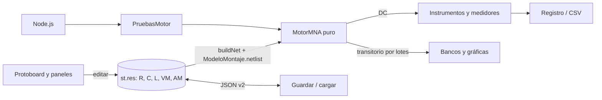

# Laboratorio virtual de circuitos R, C y L — Informe de la Fase 1

**Electricidad y Magnetismo · 2026-2 · Pontificia Universidad Javeriana Cali**
**Grupo:** [NOMBRES DE LOS INTEGRANTES] · **Entrega:** semana 12
**Prototipo:** `simulador_v1.html` (incrementos 1–5) · **Pruebas:** botón «Ejecutar pruebas del motor» del prototipo

> **Declaración de uso de IA.** El desarrollo contó con la asistencia de un modelo de lenguaje (Claude, Anthropic) para analizar el código base, generar borradores de funciones y pruebas y redactar documentación. Todas las decisiones se verificaron con pruebas automáticas contra soluciones analíticas. El grupo revisó el código y debe poder explicarlo (ver `guia_de_estudio.md`).

---

## 1. Análisis del simulador base

`simulador_protoboard_dc.html` es una sola página HTML (1 149 líneas) con un único `<script>` dividido en 15 secciones.

| Aspecto | Dónde | Qué hace |
|---|---|---|
| **Estado** | `st` (sección 4) | `wires` (cables), `res` (R1…R6 con bandas y desviación `dev` dentro de la tolerancia), `srcs` (3 fuentes `{V, on}`), registro y herramienta activa |
| **Puntos de conexión** | `PT` y `buildPoints()` | cada orificio o borne con su nodo: columna superior `T c`, inferior `B c`, rieles `RTP/RTN/RBP/RBN`, bornes de fuentes y de instrumentos |
| **Red** | `buildNet()` (sección 5) | lista `els = [[nodoA, nodoB, R, etiqueta]]`: cables (0,02 Ω), resistencias (`Rval`), r interna de las fuentes (`RINT` = 0,5 Ω), voltímetro (10 MΩ) y amperímetro (0,1 Ω) |
| **Solución** | `solveDC()` y `gauss()` | MNA con una incógnita por nodo y una por fuente. Cada nodo fuga 1/`LEAK` (1 nS) a una masa virtual: no hay nodo de tierra. `gauss()` hace eliminación gaussiana con pivoteo parcial y **ignora en silencio** los pivotes nulos |
| **Óhmetro** | `solveOhm()` | inyecta `OHM_I` = 1 mA y mide ΔV |
| **Dibujo** | sección 7 | capas SVG (`lBoard`, `lWires`, `lRes`…) regeneradas con `innerHTML` |
| **Lecturas** | `renderReadings()` (cada 340 ms) | resuelve, agrega ruido (`noisy`, ±0,5 %) y muestra en las pantallas LCD |
| **Interfaz y datos** | secciones 10–14 | arrastre, cables, paneles, registro, CSV, JSON `{wires, res, srcs}`, ejemplos `preset()` |

**Consecuencias para el diseño.**

* No hay tierra explícita, pero el osciloscopio necesita una referencia.
* Las cantidades son fijas: 6 resistencias, 3 fuentes y 1 instrumento de cada tipo.
* Las lecturas tienen ruido y las resistencias una desviación aleatoria. Para validar se usa el valor calculado por el motor, con las resistencias en su valor nominal.
* Un sistema singular no produce ningún mensaje.

## 2. Requisitos priorizados y verificables

M = obligatorio, S = importante, C = opcional.

| ID | Requisito | P | Criterio de aceptación |
|---|---|---|---|
| RF-01 | Conservar las funciones del base | M | Los 4 ejemplos dan las mismas lecturas que el original (< 10⁻⁹) |
| RF-02 | R, C (1 pF–1 F) y L (1 µH–10 H) ilimitados y ajustables | M | 300 componentes, valores con prefijo y E12, guardar y cargar |
| RF-03 | Fuentes DC ilimitadas | M | varias fuentes en un circuito; KCL y balance < 10⁻⁶ |
| RF-04 | Fuente variable con deslizador | M | la solución sigue al deslizador; superposición < 1 % |
| RF-05 | Generador seno, cuadrada (ciclo útil) y triangular | M | f(t) = fórmula; media de la cuadrada = dc + A(2D − 1) |
| RF-06 | Voltímetros y amperímetros ilimitados (R_in, R_shunt) | M | 5 medidores a la vez; efecto de carga = R_th/(R_in + R_th) |
| RF-07 | Óhmetro conservado | M | valores dorados del original |
| RF-08 | Osciloscopio ≥ 2 canales, 10 × 8, t/div, V/div, disparo | M | período, amplitud y τ medidos con error < 1–2 % |
| RF-09 | Transitorios RC, RL, RLC y régimen senoidal | M | protocolo P1–P4 dentro del criterio |
| RF-10 | Registro, CSV y JSON extendidos | M | ida y vuelta guardar → cargar sin cambios |
| RF-11 | Ejemplos RC, RL, RLC, filtros y los 4 originales | M | un JSON por prueba |
| RF-12 | Bode, X-Y, potencia y energía | C | solo con el alcance base completo |
| RNF-01 | Un solo HTML, sin bibliotecas | M | funciona sin red; sin `<script src>` |
| RNF-02 | Motor puro, probado en Node | M | `node pruebas/ejecutar_pruebas.js` termina con código 0 |
| RNF-03 | Exactitud | M | < 1 % estable, < 2 % transitorio |
| RNF-04 | Paso controlado y verificado | M | Δt automático; cambio con Δt/2 < 1 % |
| RNF-05 | Casos límite con mensaje, sin bloqueo | M | flotante, malla de fuentes, corto, valor ≤ 0, singular |
| RNF-06 | Fluidez | M | 300 componentes × 20 000 pasos < 10 s; sin congelar la interfaz |

## 3. Modelo físico y numérico

**MNA.** Se resuelve A·x = b, con x = [tensiones de nodo | corrientes de rama]. Cada elemento escribe su «sello» en A y en b:

* conductancia g entre los nodos i y j: A_ii += g, A_jj += g, A_ij −= g, A_ji −= g;
* fuente de tensión E en la rama k: A_ik = A_ki = 1, A_jk = A_kj = −1, b_k = E.

La convención es pasiva: i entra por n1, y p = v·i es la potencia absorbida (negativa en una fuente que entrega energía).

**Modelos compañeros** (paso h):

| | Euler hacia atrás (orden 1) | Trapezoidal (orden 2) |
|---|---|---|
| C: i = C dv/dt | G = C/h, J = G·v_n | G = 2C/h, J = G·v_n + i_n |
| L: v = L di/dt | G = h/L, I_eq = i_n | G = h/(2L), I_eq = i_n + G·v_n |
| Factor por paso en un RC | 1/(1 + h/τ) ∈ (0, 1): nunca oscila | (1 − h/2τ)/(1 + h/2τ): oscila si h > 2τ |

**Arranque.** En t = 0⁺ se resuelve el circuito con cada C reemplazado por una fuente v_C(0) y cada L por una fuente i_L(0). Así se obtienen i_C(0⁺) y v_L(0⁺), que el método trapezoidal necesita para arrancar bien.

**Paso de tiempo y convergencia.**

* Paso automático: Δt = mín(1/(50·|s|máx), T/200). |s|máx sale de la matriz de estado del circuito: exacta con 2 variables de estado o menos, por la fórmula de Gelfand con más.
* Verificación: se repite con Δt/2. Por Richardson, error ≈ Δ·2^p/(2^p − 1), y se exige Δ < 1 %.

**Solver.** Factorización LU con pivoteo parcial: es la misma eliminación de `gauss()`, guardando los multiplicadores. Se factoriza una vez por Δt y cada paso cuesta una sustitución (n² operaciones). Un pivote nulo produce un mensaje («sistema singular: la corriente de V2 no queda determinada…»).

**Instrumentos.** El voltímetro es R_in = 10 MΩ entre sus puntas; el amperímetro es R_shunt = 0,1 Ω en serie. Ambos son configurables y están documentados en la interfaz.

**Predicciones de las pruebas:**

* P1: τ = 1 ms y ½CV² = 50 µJ.
* P2: τ = 0,1 ms e I∞ = 0,1 A.
* P3: ω0 = 10⁴ rad/s, f0 = 1 591,5 Hz y R_crít = 200 Ω. Con R = 20 Ω: α = 1 000 s⁻¹, f_d = 1 583,6 Hz y Q = 5.
* P4: f_c = 159,15 Hz, con |H| = 0,7071 y φ = −45°.
* P5: V_a = 8,1207 V e I2 = −1,418 mA.

## 4. Arquitectura e interfaz



Bloques del HTML: `motor-mna` y `pruebas-motor` (puros, sin DOM), `modelo-montaje` (puro), `montaje-ui`, el `<script>` del base, `ui-componentes` y `ui-temporal`.

**Estructura para cantidades ilimitadas.** `st.res` es un mapa dinámico `{id → {tipo:'R'|'C'|'L'|'VM'|'AM', valor o bandas, a, b}}`. Una entrada sin tipo es una R, así que los JSON del base siguen cargando.

**Bocetos** (implementados en el prototipo):

```
┌ Panel izquierdo ───────────────┐ ┌ Área principal ─────────────────────────────────┐
│ Fuentes DC (deslizador 0–30 V) │ │ [Fuente 1][Fuente 2][Fuente 3]                  │
│ Resistencias (bandas)          │ │ ┌ Protoboard 30 columnas ┐ ┌ Bandeja ◀ 1/2 ▶ ┐ │
│ Componentes y medidores        │ │ │ R  C  L  V  A           │ │ R7  C1  L1  VM1 │ │
│  + R + C + L + V + A           │ │ └─────────────────────────┘ └─────────────────┘ │
│  C1 [1 ] µF  E12   ✕           │ │ [Voltímetro][Amperímetro][Óhmetro]              │
│ Lecturas + avisos + medidores  │ ├ Bancos de transitorios ─────────────────────────┤
│ Ejemplos (serie…P5)            │ │ circuito, fuente/generador, Δt auto, gráfica,   │
│ Registro · CSV · JSON          │ │ teoría vs. motor, Δt/2 (Richardson), pruebas    │
└────────────────────────────────┘ └─────────────────────────────────────────────────┘
```

En la Fase 2 se agrega la tarjeta del osciloscopio sobre el montaje (10 × 8, canales como sondas, disparo, cursores, PNG y CSV).

## 5. Plan de validación y primeras pruebas

El plan completo está en `plan_validacion.md`: circuitos P1–P5 con sus valores, las magnitudes que se miden, cómo se miden y los criterios de 1 % estable, 2 % transitorio y 0,5° de fase.

**Primera prueba RC** (motor frente a v_C = V(1 − e^(−t/τ)), con Δt = τ/50):

| Magnitud | Teórico | Euler | Error | Trapezoidal | Error |
|---|---|---|---|---|---|
| v_C(τ) | 6,3212 V | 6,2847 V | 0,58 % | 6,3213 V | 0,002 % |
| τ al 63,2 % | 1 ms | 1,0099 ms | 0,99 % | 0,9999 ms | 0,011 % |
| Error máx. de v_C(t) | — | 0,365 % | ✔ | 0,0012 % | ✔ |
| Cambio con Δt/2 | — | 0,18 % | ✔ | 0,0009 % | ✔ |

**Estado del prototipo al cierre de la Fase 1** (pruebas internas de `simulador_v1.html`): 292/292 pruebas del motor (RC, RL, RLC en los 3 regímenes, generador, Δt automático, AC frente al divisor de impedancias, casos límite, P5), 4/4 ejemplos del base frente a los valores dorados y 9/9 de P5 en el protoboard.

Hallazgos que ya entran en el análisis:

* El método de Euler amortigua artificialmente el RLC: α es un 9,8 % mayor, igual a la predicción ln[(1 + αΔt)² + (ω_dΔt)²]/(2Δt).
* El método trapezoidal pierde un orden de precisión en los flancos de una onda cuadrada si no se reinicia el estado. Por eso el motor lo reinicia en cada flanco.
* La fuga GMIN fija un piso de exactitud de ~10⁻⁶.

## 6. Cronograma y roles

Roles rotativos cada dos semanas: **L** líder e integración, **M** motor y pruebas, **I** interfaz, **D** documentación y validación.

| Semana | Trabajo | L | M | I | D |
|---|---|---|---|---|---|
| 10 | Análisis del base, requisitos, plan; incremento 1 (motor y RC) | [A] | [B] | [C] | [D] |
| 11 | Incrementos 2–3 (L, RLC, generador, Δt automático) | [A] | [B] | [C] | [D] |
| 12 | Incrementos 4–5 (protoboard con el motor, componentes y medidores ilimitados); **entrega Fase 1** | [B] | [C] | [D] | [A] |
| 13 | Incremento 6 (osciloscopio sobre el montaje) | [B] | [C] | [D] | [A] |
| 14 | Incremento 7 (ejemplos JSON, capturas, anexos) | [C] | [D] | [A] | [B] |
| 15 | Incremento 8 (validación P1–P5, rendimiento) | [C] | [D] | [A] | [B] |
| 16–17 | Informe final, manual, guía de estudio, ensayo de sustentación; **entrega Fase 2** | [D] | [A] | [B] | [C] |

[A]–[D] = integrantes del grupo: completar. El repositorio git registra los incrementos. Cada integrante debe hacer commits con su propio nombre para que se vean las contribuciones de todos.

## 7. Bitácora resumida

Ver `bitacora.md`. Resumen:

* Análisis del base y plan (14-oct).
* Incrementos 1–3: motor MNA, RC/RL/RLC, generador y Δt automático (14–15 oct).
* Incrementos 4–5: protoboard con el motor, componentes y medidores ilimitados, P5 (15 oct).

Las fechas de reuniones y la distribución real del trabajo las registra el grupo.
