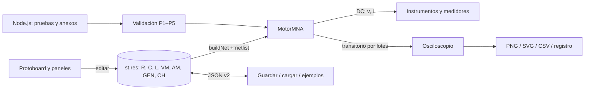

# Laboratorio virtual de circuitos R, C y L con osciloscopio: diseño, simulación por análisis nodal modificado y validación frente a la teoría

**Informe final — Fase 2**

Electricidad y Magnetismo · Periodo 2026-2
Pontificia Universidad Javeriana Cali · Facultad de Ingeniería y Ciencias

**Integrantes:** [NOMBRES DE LOS INTEGRANTES]
**Profesor:** [NOMBRE DEL PROFESOR]
**Fecha:** [FECHA DE ENTREGA, semana 16/17]

Entregables: `simulador.html` (simulador final), `ejemplos/*.json`, `resultados/`, `manual_usuario.md`, `guia_de_estudio.md`, `bitacora.md`, `README.md`

---

## Resumen

Se amplió el laboratorio virtual de protoboard y circuitos DC entregado en el curso hasta convertirlo en un laboratorio de circuitos R, C y L en el tiempo. El simulador final, un único archivo HTML sin dependencias, admite resistencias, capacitores, inductores, fuentes DC, una fuente variable y un generador de funciones (senoidal, cuadrada y triangular), todos sin límite de cantidad, junto con voltímetros, amperímetros y sondas de un osciloscopio de 10 × 8 divisiones con disparo, cursores y exportación. El cálculo se hace con un motor de análisis nodal modificado (MNA) con modelos compañeros de Euler hacia atrás y trapezoidal, paso de tiempo elegido a partir de las frecuencias naturales del circuito y verificación por división del paso. La validación compara 99 magnitudes de tensión y corriente, medidas sobre 11 montajes que cubren las pruebas RC, RL, RLC, AC y DC, con fórmulas cerradas que incluyen las resistencias parásitas del montaje. Las 99 cumplen el criterio de 1 % en régimen estable, 2 % en transitorios y 0,5° en fase, con errores entre 10⁻⁶ y 0,1 %. Frente a la teoría ideal, las diferencias llegan al 71 % y se explican por la resistencia interna del generador y por la carga de los instrumentos. Los cuatro ejemplos originales reproducen el simulador base a menos de 10⁻¹¹.

---

## 1. Introducción y objetivos

El simulador base del curso, `simulador_protoboard_dc.html`, permite armar circuitos resistivos en una protoboard y medirlos con un voltímetro, un amperímetro y un óhmetro. Resuelve el circuito en régimen DC con un sistema lineal de análisis nodal. Su límite es justamente ese: no tiene elementos que almacenen energía ni fuentes que varíen en el tiempo, de modo que los fenómenos centrales del curso (constantes de tiempo, oscilación amortiguada, resonancia, impedancia y fase) quedan fuera.

**Objetivo general.** Ampliar el laboratorio virtual con capacitores, inductores, fuentes variables, generador de señales, medidores ilimitados y un osciloscopio, y validar su funcionamiento midiendo tensión y corriente en circuitos RC, RL, RLC y en combinaciones, comparando con la teoría.

**Objetivos específicos.**

1. Analizar el código base y conservar todas sus funciones, verificándolo con pruebas de regresión.
2. Implementar un motor de simulación en el tiempo (MNA con modelos compañeros) con paso controlado y verificable.
3. Llevar al protoboard componentes, fuentes, generador y medidores sin límite de cantidad, y agregar un osciloscopio de varios canales.
4. Definir y ejecutar un protocolo de validación (P1–P5) con criterios cuantitativos y explicar físicamente cada discrepancia.

## 2. Marco teórico

### 2.1 Elementos y leyes

Con la convención pasiva (la corriente i entra por el terminal + y v = v₊ − v₋):

* **Resistencia:** v = R·i. Disipa p = R·i².
* **Capacitor:** i = C·dv/dt. Almacena E = ½Cv². En DC es un circuito abierto, y su tensión no puede saltar.
* **Inductor:** v = L·di/dt. Almacena E = ½Li². En DC es un cortocircuito, y su corriente no puede saltar.

Las leyes de Kirchhoff (corrientes en cada nodo y tensiones en cada malla) completan el sistema. El teorema de Tellegen garantiza que Σ v·i = 0 sobre todos los elementos, es decir, que la potencia entregada es igual a la absorbida.

### 2.2 Transitorios de primer orden

En un **RC serie** con un escalón V aplicado en t = 0 y C descargado:

* v_C(t) = V(1 − e^(−t/τ)) e i(t) = (V/R)·e^(−t/τ), con τ = RC;
* en t = τ, v_C llega al 63,2 % de su valor final;
* la fuente entrega CV² y la resistencia disipa ½CV², sin importar el valor de R.

En un **RL serie**:

* i(t) = (V/R)(1 − e^(−t/τ)) y v_L(t) = V·e^(−t/τ), con τ = L/R.

Con una **onda cuadrada** cuyo semiperíodo es mucho mayor que τ, cada flanco produce una carga o descarga completa. Si el semiperíodo es comparable con τ, se llega a un régimen periódico cuyos extremos se obtienen imponiendo que la señal se repita en cada período.

### 2.3 RLC serie

La tensión del capacitor cumple L·C·v'' + R·C·v' + v = V, cuyo polinomio característico es s² + 2α·s + ω0² = 0, con α = R/(2L) y ω0 = 1/√(LC). Según el signo de α − ω0 hay tres regímenes:

* **Subamortiguado** (R < R_crít = 2√(L/C)): oscila con ω_d = √(ω0² − α²) bajo una envolvente e^(−αt). El primer sobrepico vale V(1 + e^(−απ/ω_d)), y el factor de calidad es Q = ω0/(2α) = (1/R)√(L/C).
* **Crítico** (R = R_crít): v = V[1 − (1 + αt)e^(−αt)].
* **Sobreamortiguado:** dos exponenciales reales con s₁,₂ = −α ± √(α² − ω0²).

Con L = 10 mH y C = 1 µF: ω0 = 10⁴ rad/s, f0 = 1 591,5 Hz y R_crít = 200 Ω.

### 2.4 Régimen senoidal

Con fasores, cada elemento es una impedancia: Z_R = R, Z_L = jωL y Z_C = 1/(jωC). La tensión en un elemento sale del **divisor de impedancias** V_k = V·Z_k/Z_total. El desfase entre dos señales se mide con el retardo Δt entre sus cruces por cero: φ = −360°·f·Δt.

* En el **RC**, la salida en C es un pasa-bajas H = 1/(1 + jωRC) y la salida en R un pasa-altas. En la frecuencia de corte f_c = 1/(2πRC), ambas valen |H| = 1/√2 (−3 dB), con fases de −45° y +45°.
* En el **RLC serie en resonancia** (f0), Z_L + Z_C = 0: la impedancia es R, la corriente queda en fase con la fuente y |V_C| = |V_L| = Q·|V|.

### 2.5 Análisis nodal modificado

El método de la referencia [1], base de SPICE [2], escribe la ley de corrientes en cada nodo y agrega una incógnita de corriente por cada fuente de tensión. El resultado es el sistema A·x = b, que se arma sumando la contribución («sello») de cada elemento.

## 3. Diseño del simulador

### 3.1 Arquitectura

El simulador final es `simulador.html`. Es un solo archivo, sin bibliotecas ni CDN, y funciona al abrirlo con doble clic. Su código está separado en bloques con responsabilidades distintas. Los bloques puros (sin DOM) se prueban en Node.js con el mismo código que corre en el navegador.

| Bloque | Responsabilidad | DOM |
|---|---|---|
| `motor-mna` | MNA, modelos de R, V, I, C, L y generador; factorización LU; DC, transitorio por lotes, matriz de estado, Δt automático | no |
| `modelo-montaje` (a) | modelo de datos: componentes ilimitados, netlist del protoboard, E12, validación, diagnóstico, JSON y catálogo de ejemplos | no |
| `osciloscopio-logica` (d) | plan de simulación del montaje, disparo, medidas automáticas, pantalla SVG, CSV | no |
| `pruebas-motor` y `validacion-protocolo` | soluciones analíticas, mediciones, pruebas y protocolo P1–P5 | no |
| `montaje-ui`, `<script>` del base, `ui-componentes`, `ui-osciloscopio`, `ui-validacion`, `ui-temporal` | dibujo del protoboard (c), paneles, osciloscopio, bancos (e) | sí |

**Modelo de datos.** Todos los componentes viven en el mapa dinámico `st.res` (nombre heredado del base), con identificador, tipo, valor y terminales. Una entrada sin tipo es una resistencia, de modo que los ejemplos y los JSON del base siguen funcionando. Cada componente se traduce en uno o dos elementos del motor (`ModeloMontaje.elementoMotor`):

* el voltímetro es R_in entre sus puntas y el amperímetro R_shunt en serie;
* la sonda del osciloscopio es R_in = 1 MΩ;
* el generador es una fuente ideal más su r_int.

**Cambios en el código del base.** Se modificaron 13 funciones y no se eliminó ninguna; cada cambio está marcado `[incr. N]`. Por ejemplo, `buildNet` separa C, L y medidores, y `solveDC`/`solveOhm` resuelven con el motor conservando su firma. Las pruebas comparan el archivo final con el original y generan la lista de funciones modificadas. `gauss()` se conserva sin cambios y la prueba de regresión la usa (anexo C).

### 3.2 Modelo numérico

**Modelos compañeros.** Con paso h, cada C y cada L se reemplaza por una conductancia en paralelo con una fuente que depende del paso anterior:

| | Euler hacia atrás | Trapezoidal |
|---|---|---|
| Capacitor | G = C/h, J = G·v_n | G = 2C/h, J = G·v_n + i_n |
| Inductor | G = h/L, I_eq = i_n | G = h/(2L), I_eq = i_n + G·v_n |
| Orden | 1 | 2 |
| Estabilidad | L-estable: nunca oscila | A-estable, no L-estable: oscila numéricamente si h > 2τ [5, 6] |

**Detalles que garantizan la exactitud:**

1. **Estado consistente en t = 0⁺:** C se trata como una fuente v_C(0) y L como una fuente i_L(0). Así se obtienen i_C(0⁺) y v_L(0⁺) sin suponerlos.
2. **Reinicio en cada flanco** de la onda cuadrada y en cada cambio de la fuente variable. Se vuelve a resolver el sistema de t = 0⁺ con el valor nuevo de la fuente. Sin esto, el método trapezoidal promedia la corriente de antes y después del salto y cae a orden 1. Medido: error de 0,68 % y orden 1,00 sin reinicio, frente a 0,0004 % y orden 2,00 con reinicio.
3. **Factorización LU** con pivoteo parcial: es la eliminación de `gauss()` del base guardando los multiplicadores [7]. Con h fijo, A no cambia: se factoriza una vez y cada paso cuesta una sustitución (n² operaciones). Un pivote nulo produce un mensaje que nombra la incógnita indeterminada.
4. **Paso automático.** El motor arma la **matriz de estado** del circuito, poniendo cada variable de estado en 1 y resolviendo el sistema de t = 0⁺. De ella obtiene |s|máx: con 2 variables o menos de forma exacta, y con más por la fórmula de Gelfand ρ(A) = lím ‖A^k‖^(1/k) [8]. Luego toma Δt = mín(1/(50·|s|máx), T/200, pantalla/1000) y lo alinea con los flancos del generador.
5. **Verificación con Δt/2.** Por extrapolación de Richardson [9], error(Δt) ≈ Δ·2^p/(2^p − 1). Exigir Δ < 1 % garantiza un error < 2 % incluso con Euler, sin necesidad de conocer la solución.
6. **GMIN = 1 nS** de cada nodo a tierra, el mismo 1/LEAK del base. Evita que un nodo flotante vuelva singular el sistema. Su efecto relativo es del orden de R·GMIN, unos 10⁻⁶.

**Casos límite, con mensaje y sin bloquear:** valor ≤ 0 o fuera de rango, terminal sin conectar, fuente en cortocircuito, dos fuentes distintas en paralelo o inductor directo sobre una fuente en DC (sistema singular), nodo flotante, circuito sin tierra, terminal en el aire y componente sin fuente.

**Desempeño.** La simulación avanza por lotes de 15 ms que ceden el control con `setTimeout`, así que la interfaz no se congela. Una red de 301 elementos se simula durante 20 000 pasos en 0,9–2,9 s.

### 3.3 Interfaz

Se conservó el estilo del base: tema oscuro, secciones plegables y la protoboard con sus instrumentos. Se agregaron:

* **Componentes y medidores** (panel izquierdo): «+ R / + C / + L / + Voltímetro / + Amperímetro / + Generador / + Sonda». Cada uno tiene su valor con prefijo, ayuda E12 cuando aplica y R_in, R_shunt o r_int configurables. La bandeja tiene páginas y cada componente se arrastra al protoboard.
* **Lecturas en vivo** de los medidores, un cuadro de avisos del montaje y el botón «Anotar lecturas en el registro».
* **Osciloscopio:**
  * pantalla 10 × 8 con la tierra de cada canal, base de tiempo de 1 µs a 1 s por división, V/div y posición por canal;
  * modos de encendido y de disparo por nivel y pendiente;
  * cursores de tiempo y tensión arrastrables y medidas automáticas (Vpp, Vmedia, Vrms, f y fase);
  * capturas PNG y SVG y CSV de la pantalla.
* **Ejemplos del protocolo** (11 montajes), el panel **Protocolo de validación** y los **bancos de transitorios** con la solución analítica superpuesta.

## 4. Metodología de validación

El plan completo está en `plan_validacion.md`.

1. **Montajes.** Hay 11 montajes guardados en `ejemplos/*.json`: P1a y P1b (RC con escalón y con onda cuadrada), P2a y P2b (RL), P3a, P3b y P3c (RLC con 20, 200 y 1 000 Ω), P4a (filtro RC en f_c), P4b (RLC en resonancia), P4c (RL–RC serie-paralelo) y P5 (dos mallas con cinco medidores). Las resistencias están en su valor nominal.
2. **Medición «como en el laboratorio»:**
   * valores en un instante fijo;
   * τ al 63,2 % o en un flanco;
   * picos y decremento logarítmico (recta de ln(picos) frente a t);
   * cruces por cero para f_d;
   * pendiente de ln(v∞ − v) para la constante lenta;
   * amplitud y fase por DFT en 5 períodos enteros, relativas a CH1;
   * lecturas de los medidores en DC.
3. **Dos referencias analíticas por magnitud:**
   * **Teoría del montaje:** fórmulas cerradas (Thévenin, segundo orden con la sonda en paralelo, divisor de impedancias, análisis nodal) que incluyen la r interna de las fuentes del base (0,5 Ω), la r_int del generador (50 Ω), los cables (0,02 Ω), los shunts (0,1 Ω) y la carga de sondas y voltímetros. **Contra ella se aplica el criterio.**
   * **Teoría ideal** del libro, que es informativa.
4. **Criterios:** error < 1 % en régimen estable, < 2 % en transitorios y < 0,5° en fase.
5. **Verificaciones adicionales:**
   * implementación exacta de cada método frente a su recurrencia cerrada;
   * orden de convergencia y estabilidad con h grande;
   * regresión del base con valores dorados;
   * ida y vuelta guardar → cargar en los 11 ejemplos (bit a bit);
   * rendimiento.
6. **Repetibilidad.** `node pruebas/ejecutar_pruebas.js` regenera todas las tablas (`resultados/pruebas_motor.md` y `resultados/validacion.md`), y la app ejecuta las mismas funciones con sus botones de pruebas y de validación.

## 5. Resultados por familia de circuitos

Todos los valores son **calculados por el motor** sobre el montaje del protoboard. Las tablas completas, con todas las magnitudes y su teoría ideal, están en `resultados/validacion.md` (anexo A). Las capturas están en `resultados/osciloscopio/<id>.svg` (anexo B). Resultado global: **99/99 magnitudes cumplen el criterio.**

### 5.1 P1 · RC (R = 1 kΩ, C = 1 µF)

| Magnitud (P1a, escalón de 10 V) | Simulado | Teoría del montaje | Error | Teoría ideal | Error vs. ideal |
|---|---|---|---|---|---|
| v_C(1 ms) (CH1) | 6,31661 V | 6,31658 V | 0,0005 % | 6,32121 V | 0,073 % |
| τ al 63,2 % | 999,456 µs | 999,540 µs | 0,008 % | 1 ms | 0,054 % |
| i(0⁺) en R | 9,9946 mA | 9,9946 mA | ≈ 0 % | 10 mA | 0,054 % |
| i_C(1 ms) | 3,67508 mA | 3,67511 mA | 0,0009 % | 3,67879 mA | 0,10 % |
| ½Cv_C² en 10 ms | 49,8955 µJ | 49,8955 µJ | 7·10⁻⁵ % | 49,9955 µJ | 0,20 % |

En P1b (cuadrada de 0 a 10 V a 50 Hz, generador de 50 Ω), el motor mide τ = 1,04893 ms en el flanco de bajada, frente a 1,04892 ms de la teoría del montaje (0,001 %). Es un 4,9 % mayor que RC = 1 ms porque la r_int del generador se suma a R. En el régimen periódico, v_C llega a 9,98828 V (teoría del montaje: 9,98829 V).

### 5.2 P2 · RL (R = 100 Ω, L = 10 mH)

| Magnitud | Simulado | Teoría del montaje | Error | Teoría ideal | Error vs. ideal |
|---|---|---|---|---|---|
| P2a: τ al 63,2 % de i_L | 99,4759 µs | 99,4828 µs | 0,007 % | 100 µs | 0,52 % |
| P2a: i_L final (régimen estable) | 99,4685 mA | 99,4685 mA | 5·10⁻⁶ % | 99,9955 mA | 0,53 % |
| P2a: \|v_L\| final / V | 0,0043 % | 0 % | < 1 % ✔ | — | — |
| P2b: τ en el flanco (cuadrada de 500 Hz) | 66,6667 µs | 66,6689 µs | 0,003 % | 100 µs | 33 % |
| P2b: tensión mínima en bornes del generador | −3,26613 V | −3,26613 V | 7·10⁻⁵ % | 0 V | — |

El inductor se comporta como un cortocircuito en régimen estable: |v_L| final es 0,004 % de V.

### 5.3 P3 · RLC serie (L = 10 mH, C = 1 µF, escalón de 10 V)

| Magnitud | Simulado | Teoría del montaje | Error | Teoría ideal | Error vs. ideal |
|---|---|---|---|---|---|
| P3a (20 Ω): f_d | 1 582,95 Hz | 1 583,14 Hz | 0,012 % | 1 583,57 Hz | 0,039 % |
| P3a: α (8 picos) | 1 028,26 s⁻¹ | 1 027,48 s⁻¹ | 0,076 % | 1 000 s⁻¹ | 2,8 % |
| P3a: Q | 4,862 | 4,866 | 0,087 % | 5 | 2,8 % |
| P3a: primer sobrepico de v_C | 17,2286 V | 17,2285 V | 0,0009 % | 17,2925 V | 0,37 % |
| P3a: i_L máx | 85,9396 mA | 85,9387 mA | 0,001 % | 86,26 mA | 0,37 % |
| P3b (200 Ω): i_L máx | 36,7275 mA | 36,7269 mA | 0,002 % | 36,7879 mA | 0,16 % |
| P3b: instante de i_L máx | 99,921 µs | 99,918 µs | 0,002 % | 100 µs | 0,079 % |
| P3c (1 kΩ): constante lenta −1/s₁ | 987,5 µs | 988,4 µs | 0,093 % | 989,9 µs | 0,24 % |

En P3b y P3c el sobrepico de v_C es 0, como corresponde a los regímenes crítico y sobreamortiguado. Con las resistencias del montaje, P3b queda apenas **sobreamortiguado** (α′ = 10 026 s⁻¹ > ω0′ = 10 001 rad/s).

### 5.4 P4 · Régimen senoidal

| Magnitud | Simulado | Teoría del montaje | Error | Teoría ideal | Error vs. ideal |
|---|---|---|---|---|---|
| P4a (f_c): \|v_C\|/\|v_gen\| | 0,706743 | 0,706753 | 0,0014 % | 0,707107 | 0,051 % |
| P4a: fase de v_C respecto a CH1 | −44,972° | −44,971° | 0,0008° | −45° | 0,028° |
| P4a: amplitud en bornes del generador | 975,273 mV | 975,273 mV | 2·10⁻⁵ % | 1 V | 2,5 % |
| P4b (f0): amplitud en bornes del generador | 286,011 mV | 285,808 mV | 0,071 % | 1 V | 71 % |
| P4b: amplitud de v_C | 1,4279 V | 1,42836 V | 0,032 % | 5 V | 71 % |
| P4b: \|v_C\|/\|v_gen\| (= Q relativo a los bornes) | 4,9925 | 4,9976 | 0,10 % | 5 | 0,15 % |
| P4b: fase de la corriente respecto a CH1 | −0,019° | 0° | 0,019° | 0° | 0,019° |
| P4c (1 kHz): amplitud de i_L | 7,14511 mA | 7,14608 mA | 0,014 % | 9,26912 mA | 23 % |
| P4c: fase de i_L respecto a CH1 | −48,348° | −48,353° | 0,005° | −48,352° | 0,003° |

En P4c la ley de corrientes fasorial en el nodo a se cumple con un residuo de 0,0085 %. Ese residuo es la corriente que toman las sondas de 1 MΩ.

### 5.5 P5 · DC con dos fuentes y cinco medidores

| Medidor | Simulado | Teoría del montaje | Error | Teoría ideal | Error vs. ideal |
|---|---|---|---|---|---|
| AM1 (I1, fuente 1) | 3,87859 mA | 3,87858 mA | 0,0002 % | 3,87931 mA | 0,019 % |
| AM2 (I2, fuente 2) | −1,41745 mA | −1,41745 mA | 3·10⁻⁵ % | −1,41850 mA | 0,074 % |
| AM3 (I3) | 2,46113 mA | 2,46113 mA | 4·10⁻⁵ % | 2,46082 mA | 0,013 % |
| VM2 (v_R3 = V_a) | 8,11903 V | 8,11903 V | 4·10⁻⁵ % | 8,12069 V | 0,020 % |
| Potencia entregada | 39,456 mW | 39,4557 mW | 0,0008 % | 39,4592 mW | 0,008 % |

Además se verificó, en las pruebas del motor:

* **Balance de potencia (Tellegen):** el residuo es 0,0008 %, que es la energía que se fuga por GMIN.
* **Ley de corrientes con los amperímetros:** se cumple con un residuo de 0,0004 %.
* **C abierto y L en corto en DC:** con un C en serie con R2 la rama 2 queda abierta y V_a = V1·R3/(R1 + R3) = 9,2093 V; con un L en serie con R3 nada cambia.
* **El transitorio termina en ese punto DC:** 0,0005 % y 0,005 % en 10 escalas lentas.

### 5.6 Regresión, verificación numérica y rendimiento

* **Simulador base:** los 4 ejemplos originales (voltímetro, amperímetro, corriente de la fuente y óhmetro) coinciden con los valores dorados del archivo original a menos de 10⁻¹¹ relativo (tolerancia de 10⁻⁹).
* **Implementación exacta:** frente a la recurrencia cerrada de cada método, el error es ≤ 7·10⁻¹⁵.
* **Orden de convergencia:** 0,994 con Euler y 2,089 con el trapezoidal en el RC, y 2,004 con el trapezoidal en el RLC.
* **Estabilidad:** con Δt = 5τ, Euler decae sin oscilar y el trapezoidal cambia de signo en cada paso, con el factor teórico de −0,4286.
* **Ida y vuelta guardar → cargar:** idéntica en los 11 ejemplos (JSON, todas las tensiones de nodo y todas las trazas).
* **Rendimiento:** 301 elementos (151 nodos) durante 20 000 pasos trapezoidales en 0,9–2,9 s, frente a un límite de 10 s.

## 6. Análisis y discusión

**Constante de tiempo.** En P1a el motor reproduce τ con un error de 10⁻⁴ en la teoría que incluye la fuente real. El 0,054 % que lo separa de RC corresponde exactamente a la r interna de 0,5 Ω y a los cables (0,54 Ω frente a 1 kΩ), más la sonda de 1 MΩ en paralelo con C. Las variaciones de τ en P1b (+4,9 %) y P2b (−33 %) tienen la misma causa: la resistencia del generador (50 Ω) forma parte del circuito y entra en τ = (R + r)·C y en τ = L/(R + r). En un laboratorio real, la constante de tiempo medida con un generador de 50 Ω **no** es RC. Si se compara con la teoría ideal, la discrepancia se debe a la fuente y no al circuito.

**Amortiguamiento.** En P3a la teoría ideal predice α = 1 000 s⁻¹ y el montaje da 1 027 s⁻¹ (2,8 % más), porque los 0,54 Ω de la fuente y los cables se suman a los 20 Ω de R. Con resistencias tan pequeñas, cualquier resistencia en serie cambia apreciablemente el amortiguamiento y Q: en una bobina real, la resistencia del alambre, que nuestro modelo no incluye, tendría un efecto mayor. El **crítico** de P3b resulta apenas sobreamortiguado (α′/ω0′ = 1,0025). El amortiguamiento crítico es una condición frágil: en la práctica siempre es aproximado.

**Resonancia e impedancia.** P4b es el caso más instructivo. En f0, Z_L + Z_C = 0 y la impedancia del RLC es solo R = 20 Ω. El generador real, de 50 Ω, entrega entonces en sus bornes 1·20/70 ≈ 0,286 V, el 71 % menos que el valor nominal. La relación v_C/v_bornes sigue siendo Q ≈ 5 (error de 0,15 % frente al ideal) y la corriente queda en fase con la tensión de bornes (−0,019°). La lección es de medición: hay que medir la entrada en los bornes (CH1) y no suponer la amplitud nominal. En P4c ocurre lo mismo con un efecto menor (23 %): las fases relativas a los bornes coinciden con el ideal a 0,01°, porque el divisor desde los bornes no depende de r_int.

**Fase.** Las fases se midieron por DFT y por el retardo entre cruces por cero, con errores ≤ 0,02°. La sonda de 1 MΩ en paralelo con C corre la fase del filtro 0,028° en f_c (−44,972° en vez de −45°), un efecto pequeño pero medible que la teoría del montaje reproduce.

**Energía.** En todos los RC y RLC con escalón, la energía disipada en R tiende a ½CV², independiente de R, tal como predice la teoría. El balance de energía con la cuadratura consistente con cada método permite separar dos efectos:

* **Euler** disipa energía de forma artificial: ½C·Δv² en cada paso, un 0,50 % en el RC con Δt = τ/50 y un 4,5 % en el RLC subamortiguado. Es el mismo efecto que su amortiguamiento numérico (+9,8 % en α).
* **El trapezoidal** conserva la energía hasta el piso de GMIN (~10⁻⁵).

**Fuentes de discrepancia, de mayor a menor peso:**

1. **Idealizaciones del circuito:** r interna de las fuentes, r_int del generador, cables. Pesan del 0,05 % al 71 %. No son errores del simulador sino física del montaje.
2. **Instrumentos:** sondas de 1 MΩ y voltímetros de 10 MΩ, de 10⁻⁴ a 10⁻³. Con un voltímetro de 10 kΩ el error de carga llega a 5,4 % (R_th/(R_in + R_th)).
3. **Método numérico:** con el trapezoidal y el Δt automático, de 10⁻⁵ a 10⁻⁴. Con Euler, de 0,4 % a 1 % en primer orden y hasta 10 % en α del RLC, lo que justifica usar el trapezoidal por defecto.
4. **Procedimiento de medición:** recta de ln(picos), pendientes, interpolación entre muestras, cables despreciados en AC. Es el error dominante frente a la teoría del montaje (≤ 0,1 %).
5. **GMIN:** piso de 10⁻⁶ a 10⁻⁵, visible en los balances de potencia y en la corriente de las fuentes.

**Límites del modelo.**

* Los componentes son ideales y lineales: el capacitor no tiene fugas ni polaridad, el inductor no tiene resistencia de alambre ni saturación, y no hay semiconductores.
* El protoboard no tiene capacitancias parásitas entre filas.
* Las lecturas de los medidores nuevos no tienen ruido.
* Con más de 2 variables de estado, la escala lenta se estima como 1/mín|s|, así que el tiempo de estabilización automático puede quedar corto en modos poco amortiguados.
* Con generadores de distinta frecuencia, Δt se alinea solo con el de mayor frecuencia.

## 7. Conclusiones y trabajo futuro

1. Se construyó un laboratorio virtual de circuitos R, C y L en un solo archivo HTML. Conserva todas las funciones del simulador base, verificado con valores dorados a 10⁻¹¹, y agrega componentes, fuentes, generador, medidores y canales de osciloscopio sin límite de cantidad.
2. El motor MNA con modelos compañeros reproduce las soluciones analíticas con errores de 10⁻⁶ a 0,1 % frente a la teoría del montaje. Las 99 magnitudes del protocolo P1–P5 cumplen el criterio (1 %, 2 % y 0,5°).
3. La comparación con la teoría ideal cuantifica las idealizaciones. La resistencia interna del generador cambia τ entre un 5 % y un 33 % y la amplitud en resonancia un 71 %; la carga de los instrumentos pesa de 10⁻⁴ a 10⁻³. Estas diferencias, y no el método numérico, dominan cualquier comparación con el laboratorio real.
4. El método trapezoidal, con estado consistente en t = 0⁺ y reinicio en los flancos, es claramente superior a Euler en circuitos oscilantes y en régimen senoidal. Euler agrega amortiguamiento y retraso de fase artificiales, que el simulador permite observar y cuantificar.
5. Todo resultado es reproducible con un comando (`node pruebas/ejecutar_pruebas.js`) o con un botón de la app.

**Trabajo futuro:**

* modelo de bobina real (resistencia de alambre) y de capacitor con fuga, con su efecto en Q;
* extras opcionales: diagrama de Bode, modo X-Y para figuras de Lissajous, y medición de potencia y energía en el osciloscopio;
* ruido opcional en los medidores nuevos;
* comparación con medidas tomadas en el laboratorio real del curso, cuya columna debe llenar el grupo.

## Referencias

[1] Ho, C.-W., Ruehli, A. E., & Brennan, P. A. (1975). The modified nodal approach to network analysis. *IEEE Transactions on Circuits and Systems, 22*(6), 504–509.

[2] Nagel, L. W. (1975). *SPICE2: A computer program to simulate semiconductor circuits* (Memorandum No. ERL-M520). University of California, Berkeley.

[3] Alexander, C. K., & Sadiku, M. N. O. (2017). *Fundamentals of electric circuits* (6th ed.). McGraw-Hill.

[4] Serway, R. A., & Jewett, J. W. (2018). *Physics for scientists and engineers* (10th ed.). Cengage Learning.

[5] Dahlquist, G. (1963). A special stability problem for linear multistep methods. *BIT Numerical Mathematics, 3*, 27–43.

[6] Hairer, E., & Wanner, G. (1996). *Solving ordinary differential equations II: Stiff and differential-algebraic problems* (2nd ed.). Springer.

[7] Golub, G. H., & Van Loan, C. F. (2013). *Matrix computations* (4th ed.). Johns Hopkins University Press.

[8] Horn, R. A., & Johnson, C. R. (2013). *Matrix analysis* (2nd ed.). Cambridge University Press.

[9] Richardson, L. F. (1911). The approximate arithmetical solution by finite differences of physical problems involving differential equations, with an application to the stresses in a masonry dam. *Philosophical Transactions of the Royal Society A, 210*, 307–357.

[10] Pillage, L. T., Rohrer, R. A., & Visweswariah, C. (1995). *Electronic circuit and system simulation methods*. McGraw-Hill.

[11] Simulador base del curso: *simulador_protoboard_dc.html* (2026). Material del curso Electricidad y Magnetismo, Pontificia Universidad Javeriana Cali.

[12] Anthropic. (2026). *Claude* [Modelo de lenguaje grande]. https://claude.ai

---

## Anexos

**A. Tablas de datos.** `resultados/validacion.md`: las 99 magnitudes de los 11 montajes, con simulado, teoría del montaje, error, criterio, teoría ideal y error frente al ideal. `resultados/pruebas_motor.md`: las 308 pruebas del motor frente a la teoría y las 86 de regresión. `resultados/osciloscopio/<id>.csv`: datos en el tiempo de cada pantalla.

**B. Capturas del osciloscopio.** `resultados/osciloscopio/<id>.svg` (P1a … P4c) y `resultados/osciloscopio/README.md`, con las medidas automáticas de cada captura.

**C. Cambios en el código del base.** Funciones modificadas: `buildNet`, `solveDC`, `solveOhm`, `drawTray`, `drawRes`, `drawOver`, `drawFlow`, `renderReadings`, `renderAnalysis`, `down`, `buildRPanel`, `updateRLabels` y `bind`. Ninguna eliminada. Lista generada en `resultados/pruebas_motor.md`, sección C. El detalle de cada cambio, con su motivo y su verificación, está en `docs/00_analisis_y_plan.md`, sección 6.9.

**D. Cálculos teóricos.** Las fórmulas de la teoría del montaje están en `plan_validacion.md` (sección 3) y en el bloque `validacion-protocolo` de `simulador.html`. Su derivación paso a paso está en `guia_de_estudio.md`.

**E. Declaración de uso de IA.** El desarrollo contó con la asistencia de un modelo de lenguaje (Claude, Anthropic [12]) en:

* el análisis del código base;
* la generación de borradores del motor, del modelo, del osciloscopio, de la interfaz y de las pruebas;
* la redacción de la documentación.

Cada resultado numérico de este informe proviene de pruebas automáticas ejecutadas sobre el código entregado. No se inventaron datos ni medidas de laboratorio. El grupo es responsable de revisar, entender y defender cada parte (ver `guia_de_estudio.md`).
