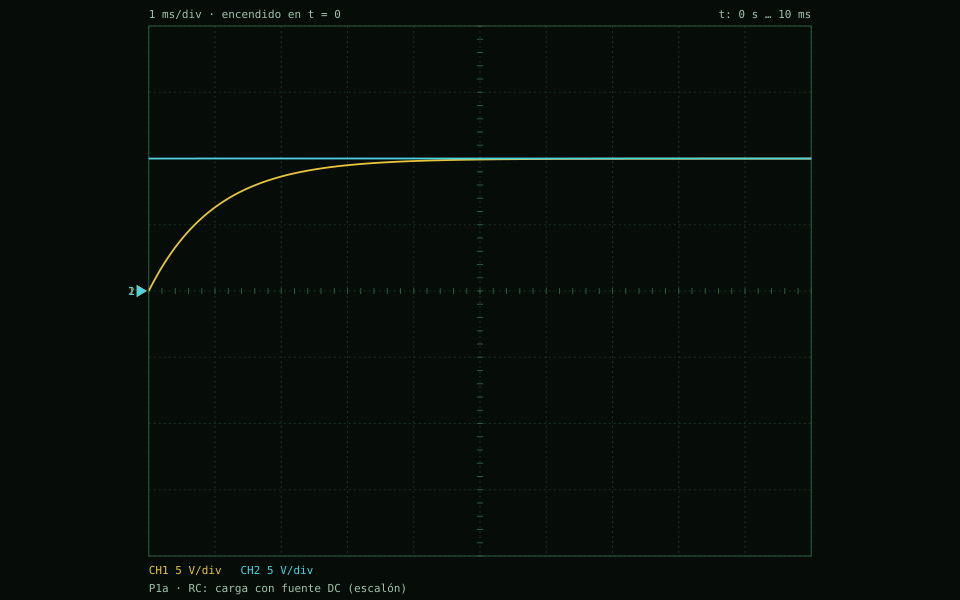
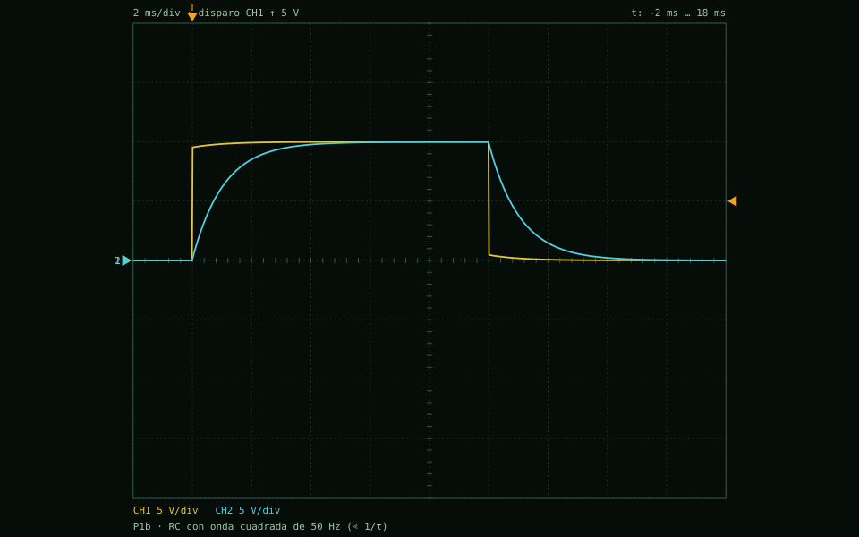
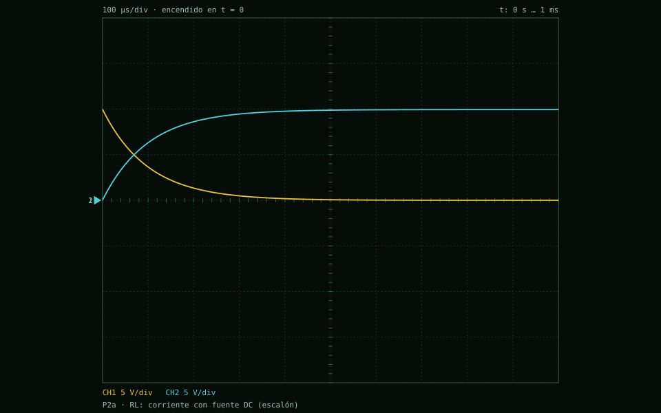
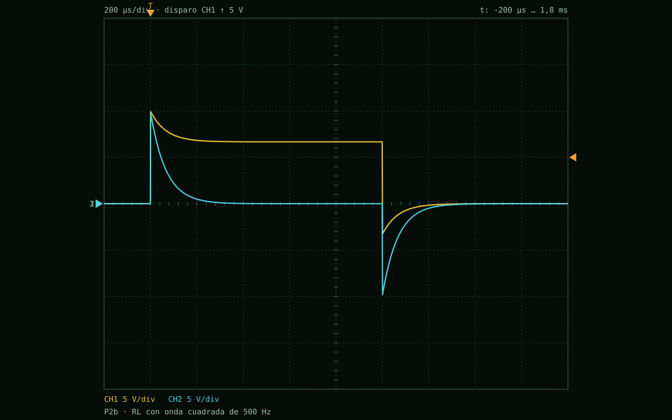
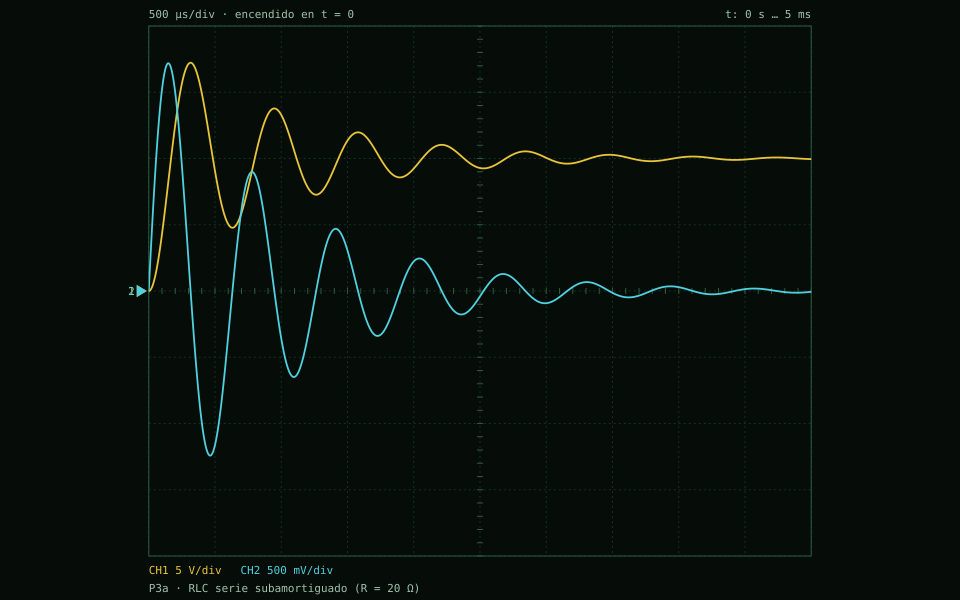
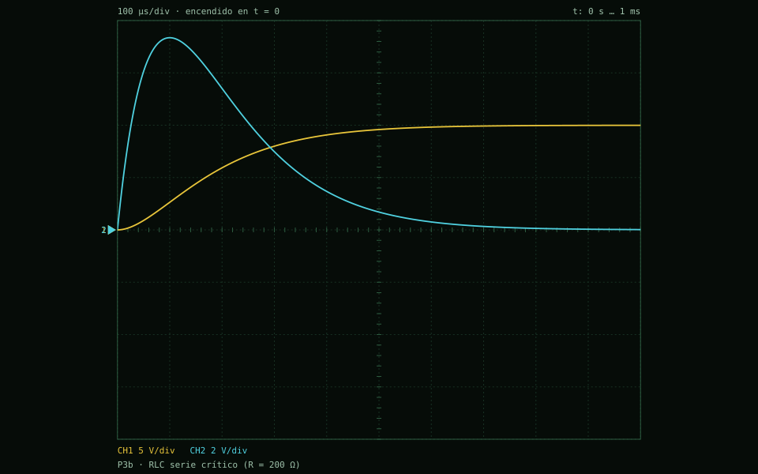
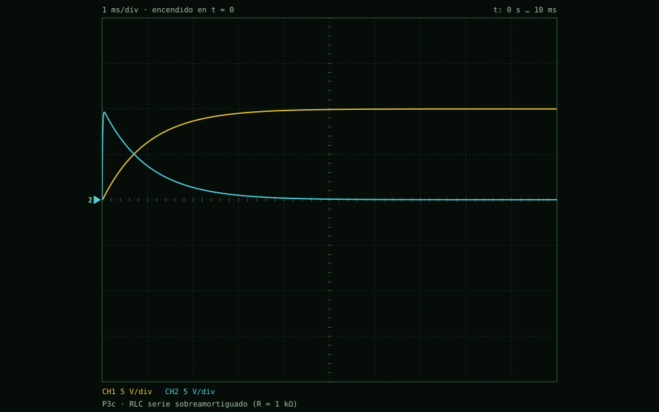
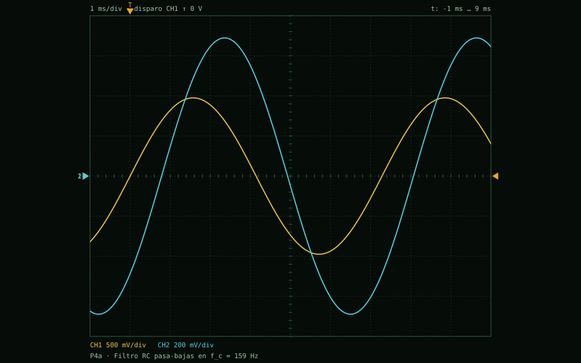
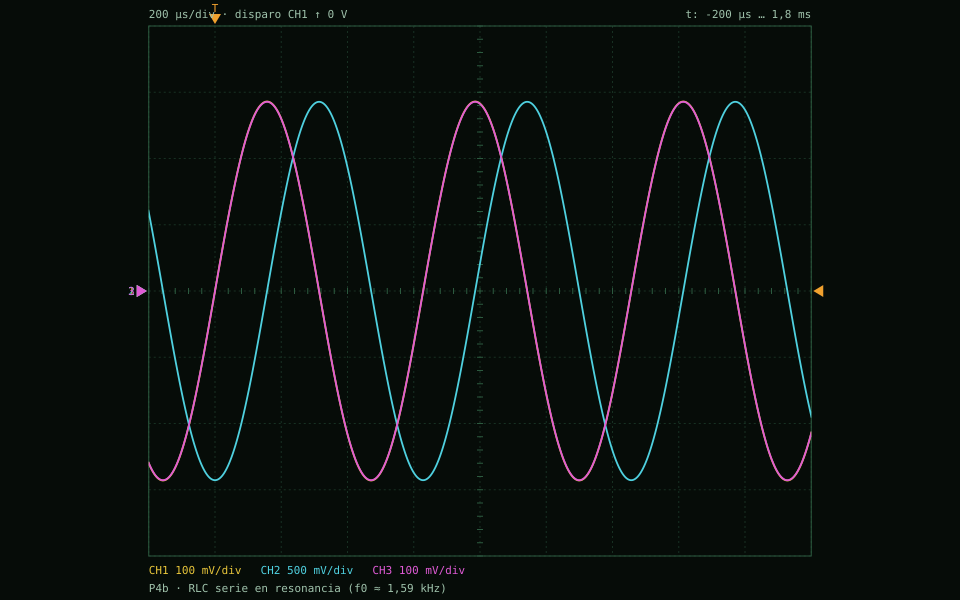
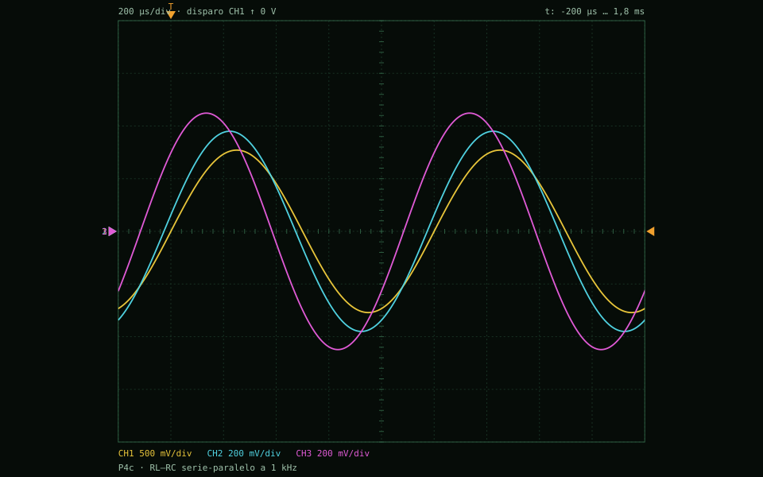

# Capturas del osciloscopio de los ejemplos del protocolo

Generado por `pruebas/generar_ejemplos.js` el 2026-10-21T01:04:32.868Z con Node v22.21.1. Valores **calculados por el motor** sobre el montaje de cada ejemplo (resistencias en valor nominal). Las medidas son las automáticas del osciloscopio sobre la pantalla mostrada.

## P1a · RC: carga con fuente DC (escalón)

Fuente 1 (10 V) → R1 (1 kΩ) → C (1 µF). CH1 sobre C (v_C), CH2 en la salida de la fuente. τ = RC = 1 ms.

Δt = 10 µs · 1000 pasos · 1 ms/div · encendido en t = 0

| Canal | Vpp | Vmáx | Vmín | Vmedia | Vrms | f | fase respecto a CH1 |
|---|---|---|---|---|---|---|---|
| CH1 | 9,99 V | 9,99 V | 0 V | 8,992 V | 9,211 V | — | — |
| CH2 | 5,391 mV | 10 V | 9,995 V | 9,999 V | 9,999 V | — | — |

## P1b · RC con onda cuadrada de 50 Hz (≪ 1/τ)

Generador cuadrado 0–10 V, 50 Hz, r_int 50 Ω → R1 (1 kΩ) → C (1 µF). CH1 = generador, CH2 = v_C. τ = (R + r_int)·C.

Δt = 20 µs · 2524 pasos · 2 ms/div · disparo en CH1 ↑ 5 V

| Canal | Vpp | Vmáx | Vmín | Vmedia | Vrms | f | fase respecto a CH1 |
|---|---|---|---|---|---|---|---|
| CH1 | 9,999 V | 9,999 V | 34,41 µV | 4,995 V | 7,033 V | — | — |
| CH2 | 9,988 V | 9,988 V | 722,7 µV | 4,99 V | 6,679 V | — | — |

## P2a · RL: corriente con fuente DC (escalón)

Fuente 1 (10 V) → R (100 Ω) → L (10 mH). CH1 sobre L (v_L), CH2 sobre R (v_R = R·i). τ = L/R = 0,1 ms.

Δt = 1 µs · 1000 pasos · 100 µs/div · encendido en t = 0

| Canal | Vpp | Vmáx | Vmín | Vmedia | Vrms | f | fase respecto a CH1 |
|---|---|---|---|---|---|---|---|
| CH1 | 9,999 V | 9,999 V | 430,9 µV | 994,7 mV | 2,23 V | — | — |
| CH2 | 9,945 V | 9,946 V | 1 mV | 8,957 V | 9,174 V | — | — |

## P2b · RL con onda cuadrada de 500 Hz

Generador cuadrado 0–10 V, 500 Hz, r_int 50 Ω → R (100 Ω) → L (10 mH). CH1 = generador, CH2 = v_L. τ = L/(R + r_int).

Δt = 1,33 µs · 3500 pasos · 200 µs/div · disparo en CH1 ↑ 5 V

| Canal | Vpp | Vmáx | Vmín | Vmedia | Vrms | f | fase respecto a CH1 |
|---|---|---|---|---|---|---|---|
| CH1 | 13,2 V | 9,933 V | -3,266 V | 3,331 V | 4,903 V | — | — |
| CH2 | 19,6 V | 9,8 V | -9,8 V | -40,52 nV | 1,807 V | — | — |

## P3a · RLC serie subamortiguado (R = 20 Ω)

Fuente 1 (10 V) → R (20 Ω) → L (10 mH) → C (1 µF). CH1 = v_C, CH2 = v_R (∝ i). f0 ≈ 1,59 kHz, R_crít = 200 Ω.

Δt = 2 µs · 2500 pasos · 500 µs/div · encendido en t = 0

| Canal | Vpp | Vmáx | Vmín | Vmedia | Vrms | f | fase respecto a CH1 |
|---|---|---|---|---|---|---|---|
| CH1 | 17,23 V | 17,23 V | 0 V | 9,959 V | 10,21 V | 1,697 kHz | — |
| CH2 | 2,961 V | 1,719 V | -1,242 V | 40,01 mV | 441,2 mV | 1,495 kHz | 32,83 ° |

## P3b · RLC serie crítico (R = 200 Ω)

Igual que P3a con R = 200 Ω = 2√(L/C): amortiguamiento crítico (la r interna de la fuente lo vuelve apenas sobreamortiguado).

Δt = 1 µs · 1000 pasos · 100 µs/div · encendido en t = 0

| Canal | Vpp | Vmáx | Vmín | Vmedia | Vrms | f | fase respecto a CH1 |
|---|---|---|---|---|---|---|---|
| CH1 | 9,993 V | 9,993 V | 0 V | 7,994 V | 8,509 V | — | — |
| CH2 | 7,344 V | 7,344 V | 857 nV | 2 V | 3,158 V | — | — |

## P3c · RLC serie sobreamortiguado (R = 1 kΩ)

Igual que P3a con R = 1 kΩ: dos exponenciales reales, sin sobrepico.

Δt = 202 ns · 49472 pasos · 1 ms/div · encendido en t = 0

| Canal | Vpp | Vmáx | Vmín | Vmedia | Vrms | f | fase respecto a CH1 |
|---|---|---|---|---|---|---|---|
| CH1 | 9,99 V | 9,99 V | 0 V | 8,993 V | 9,214 V | — | — |
| CH2 | 9,63 V | 9,63 V | 4,281 µV | 1,007 V | 2,235 V | — | — |

## P4a · Filtro RC pasa-bajas en f_c = 159 Hz

Generador seno 1 V en f_c = 1/(2πRC), r_int 50 Ω → R1 (1 kΩ) → C (1 µF). CH1 = entrada, CH2 = salida: −3 dB y −45°.

Δt = 9,99 µs · 3052 pasos · 1 ms/div · disparo en CH1 ↑ 0 V

| Canal | Vpp | Vmáx | Vmín | Vmedia | Vrms | f | fase respecto a CH1 |
|---|---|---|---|---|---|---|---|
| CH1 | 1,951 V | 975,3 mV | -975,3 mV | 141,4 mV | 686,8 mV | 159,2 Hz | — |
| CH2 | 1,379 V | 689,3 mV | -689,3 mV | 9,852 mV | 500,5 mV | 159,2 Hz | -44,97 ° |

## P4b · RLC serie en resonancia (f0 ≈ 1,59 kHz)

Generador seno 1 V en f0, r_int 50 Ω → R (20 Ω) → L (10 mH) → C (1 µF). CH1 = generador, CH2 = v_C (≈ 5 veces CH1), CH3 = v_R (en fase con CH1).

Δt = 1,99 µs · 3437 pasos · 200 µs/div · disparo en CH1 ↑ 0 V

| Canal | Vpp | Vmáx | Vmín | Vmedia | Vrms | f | fase respecto a CH1 |
|---|---|---|---|---|---|---|---|
| CH1 | 572 mV | 286 mV | -286 mV | -15,69 mV | 206,7 mV | 1,592 kHz | — |
| CH2 | 2,856 V | 1,428 V | -1,428 V | -11,41 mV | 987,1 mV | 1,592 kHz | -90,01 ° |
| CH3 | 571,2 mV | 285,6 mV | -285,6 mV | -15,66 mV | 206,4 mV | 1,592 kHz | -19,06 m° |

## P4c · RL–RC serie-paralelo a 1 kHz

Generador seno 1 V, 1 kHz, r_int 50 Ω → R1 (100 Ω) → nodo a; de a a tierra L (10 mH) en paralelo con R2 (100 Ω) + C (1 µF). CH1 = generador, CH2 = v_C, CH3 = nodo a.

Δt = 2 µs · 3000 pasos · 200 µs/div · disparo en CH1 ↑ 0 V

| Canal | Vpp | Vmáx | Vmín | Vmedia | Vrms | f | fase respecto a CH1 |
|---|---|---|---|---|---|---|---|
| CH1 | 1,542 V | 771 mV | -771 mV | -731,3 µV | 545,4 mV | 1 kHz | — |
| CH2 | 760,2 mV | 380,1 mV | -380,1 mV | -335,9 µV | 268,8 mV | 1 kHz | 9,507 ° |
| CH3 | 897,9 mV | 448,9 mV | -448,9 mV | -224,6 µV | 317,4 mV | 1 kHz | 41,65 ° |
