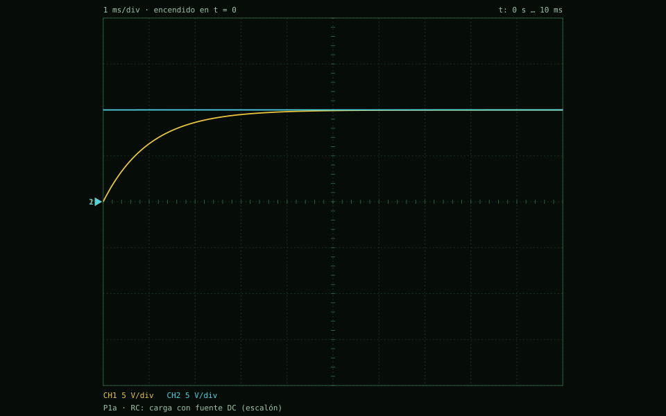
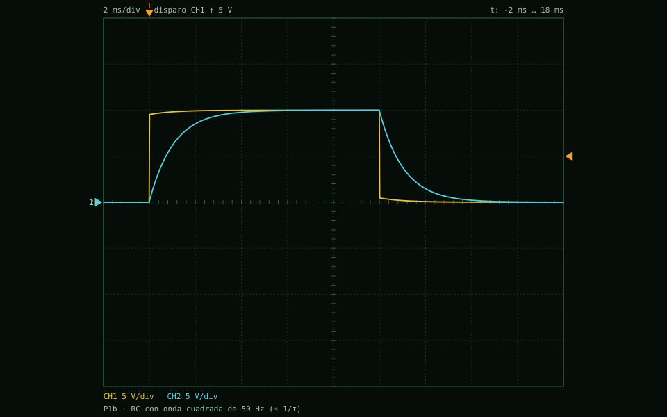
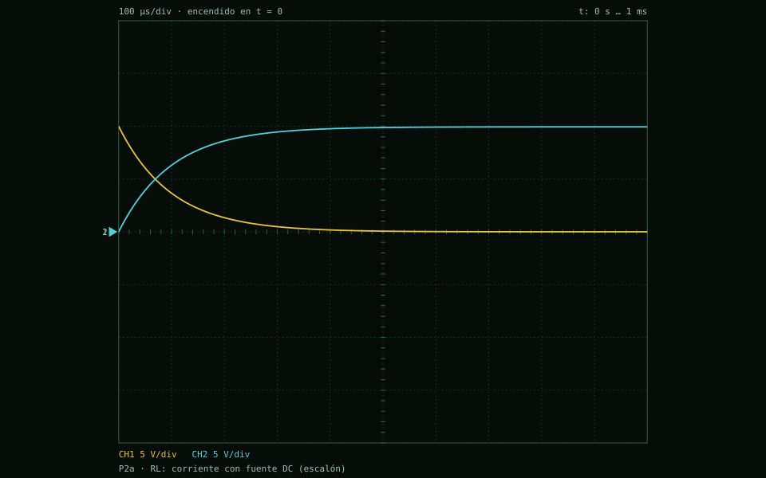
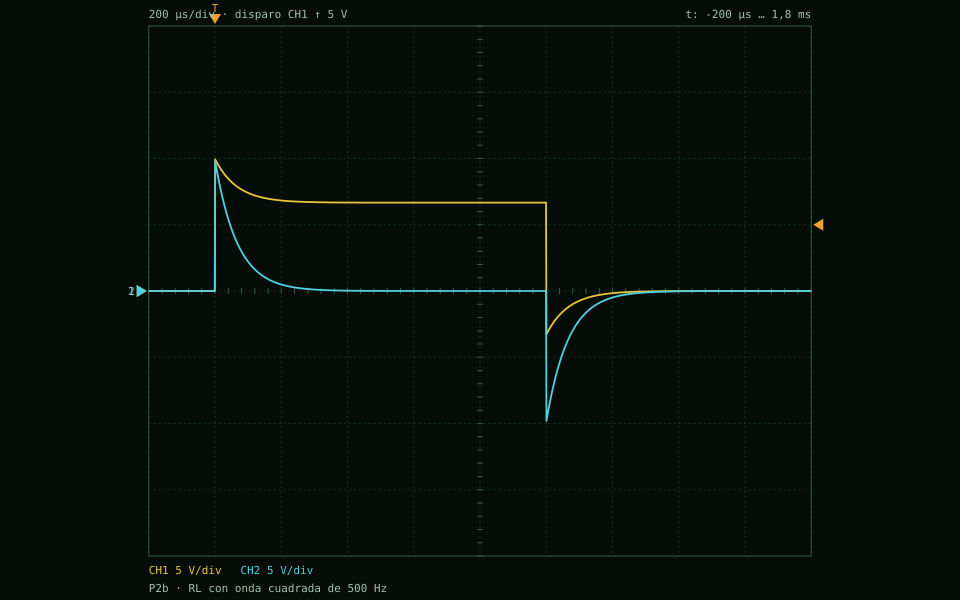
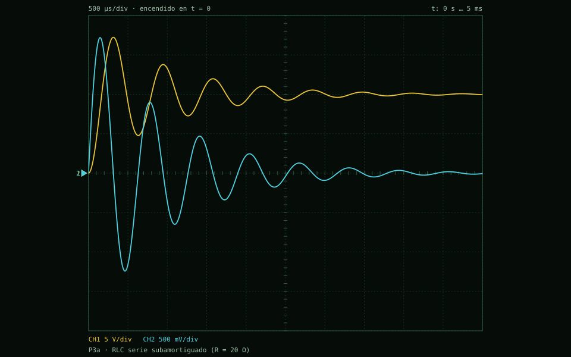
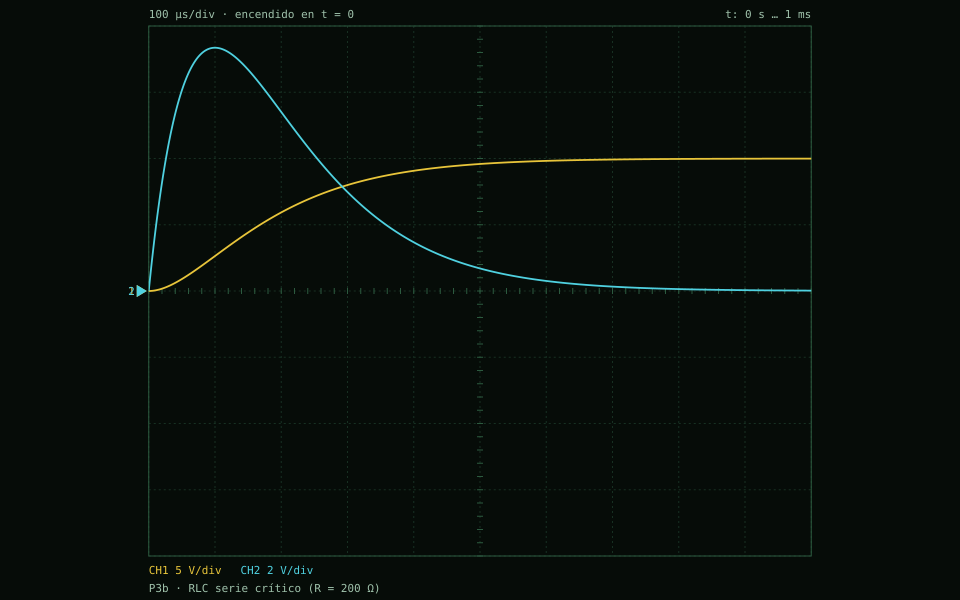
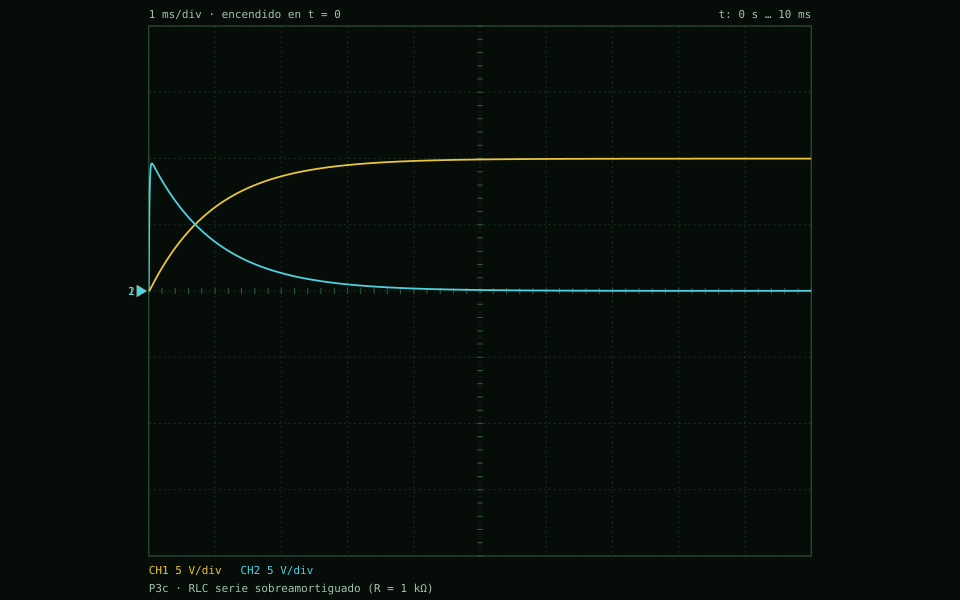
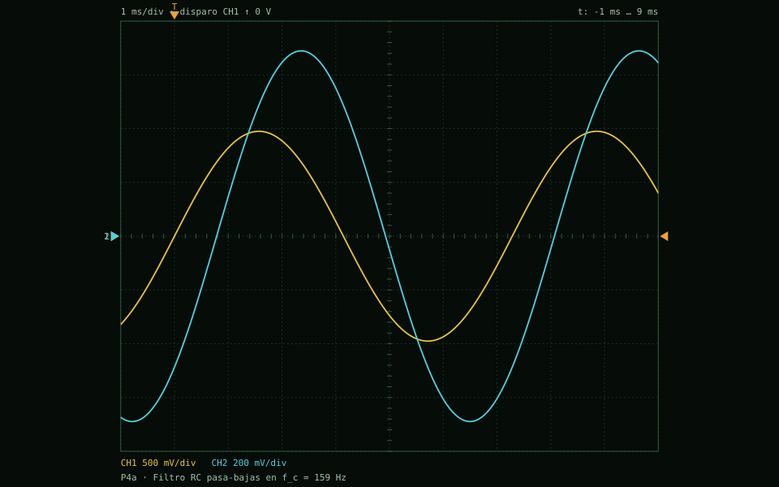
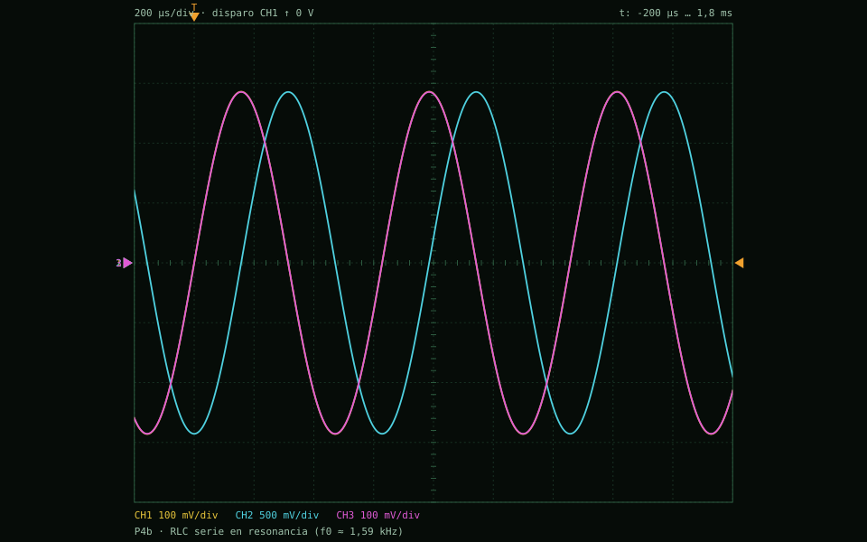
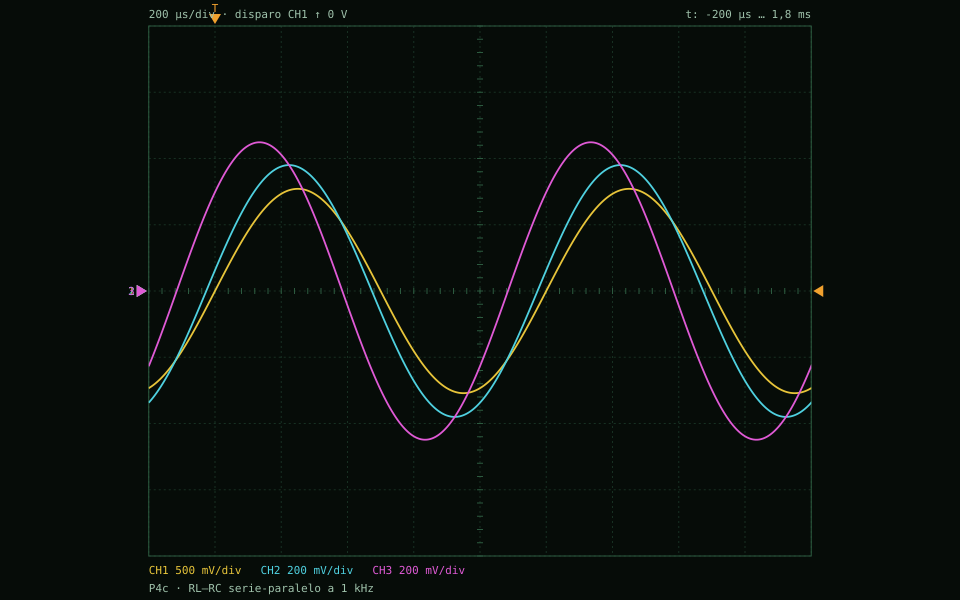

# Protocolo de validación P1–P5 sobre los montajes del protoboard

Generado por `pruebas/ejecutar_pruebas.js` el 2026-11-13T04:52:44.370Z con Node v22.21.1 (1918 ms). Cada fila compara un valor **calculado por el motor** sobre el montaje de `ejemplos/<id>.json` (medido como en el laboratorio: instante fijo, 63,2 %, picos, cruces, fasores por DFT o lectura de un medidor) con dos referencias analíticas:

* **Teoría del montaje**: fórmulas cerradas que incluyen la r interna de las fuentes (0,5 Ω), la r_int del generador (50 Ω), los cables (0,02 Ω), los shunts (0,1 Ω) y la carga de sondas (1 MΩ) y voltímetros (10 MΩ). **El criterio se aplica contra esta teoría**: 1 % en régimen estable, 2 % en transitorios y 0,5° en fase.
* **Teoría ideal** (la del libro): sin nada de lo anterior. Su error es **informativo** y mide cuánto pesa cada idealización.

En los circuitos AC se desprecian los cables (0,02 Ω frente a ≥ 20 Ω, efecto ≤ 0,2 %). Las resistencias están en su valor nominal.

**Resumen:** 99/99 magnitudes cumplen el criterio en 11 montajes.

| Ejemplo | Prueba | Magnitudes | Cumplen | Error máx. vs. montaje | Error máx. vs. ideal |
|---|---|---|---|---|---|
| P1a · RC: carga con fuente DC (escalón) | P1 | 9 | 9 | 0,00842 % | 0,2 % |
| P1b · RC con onda cuadrada de 50 Hz (≪ 1/τ) | P1 | 7 | 7 | 0,00138 % | 4,89 % |
| P2a · RL: corriente con fuente DC (escalón) | P2 | 9 | 9 | 0,00698 % | 1,05 % |
| P2b · RL con onda cuadrada de 500 Hz | P2 | 6 | 6 | 0,00332 % | 33,3 % |
| P3a · RLC serie subamortiguado (R = 20 Ω) | P3 | 11 | 11 | 0,0871 % | 2,83 % |
| P3b · RLC serie crítico (R = 200 Ω) | P3 | 7 | 7 | 0,00242 % | 0,185 % |
| P3c · RLC serie sobreamortiguado (R = 1 kΩ) | P3 | 8 | 8 | 0,0932 % | 0,24 % |
| P4a · Filtro RC pasa-bajas en f_c = 159 Hz | P4 | 8 | 8 | 0,00144 % · 0,00081° | 2,52 % · 0,0295° |
| P4b · RLC serie en resonancia (f0 ≈ 1,59 kHz) | P4 | 10 | 10 | 0,103 % · 0,0187° | 71,4 % · 0,0187° |
| P4c · RL–RC serie-paralelo a 1 kHz | P4 | 12 | 12 | 0,0183 % · 0,00561° | 22,9 % · 0,00976° |
| P5 · Dos mallas, dos fuentes y cinco medidores (DC) | P5 | 12 | 12 | 0,000773 % | 0,0737 % |

**Rendimiento (RNF-06):** red de 301 elementos (151 nodos), 20000 pasos trapezoidales en 1,35 s (14815 pasos/s) frente a un límite de 10 s: ✅ cumple.

## Tablas por montaje

### P1a · RC: carga con fuente DC (escalón)

Fuente 1 (10 V) → R1 (1 kΩ) → C (1 µF). CH1 sobre C (v_C), CH2 en la salida de la fuente. τ = RC = 1 ms.

Δt = 10 µs · 1000 pasos · 9/9 cumplen

| Magnitud | Elemento | Simulado (motor) | Teoría del montaje | Error | Criterio | ¿Cumple? | Teoría ideal | Error vs. ideal |
|---|---|---|---|---|---|---|---|---|
| v_C(1 ms), medida con CH1 | C | 6,31661 V | 6,31658 V | 0,0005 % | < 2 % | ✅ | 6,32121 V | 0,0728 % |
| τ al 63,2 % del valor final (CH1) | C | 999,456 µs | 999,54 µs | 0,00842 % | < 2 % | ✅ | 1 ms | 0,0544 % |
| i(0⁺) | R | 9,9946 mA | 9,9946 mA | 5,3e-8 % | < 2 % | ✅ | 10 mA | 0,054 % |
| v_R(1 ms) | R | 3,6814 V | 3,68143 V | 0,000858 % | < 2 % | ✅ | 3,67879 V | 0,0708 % |
| i_C(1 ms) | C | 3,67508 mA | 3,67511 mA | 0,000868 % | < 2 % | ✅ | 3,67879 mA | 0,101 % |
| v_C(10 ms), régimen estable | C | 9,98954 V | 9,98955 V | 0,0000329 % | < 1 % | ✅ | 9,99955 V | 0,1 % |
| energía ½Cv_C² en 10 ms | C | 49,8955 µJ | 49,8955 µJ | 0,0000658 % | < 1 % | ✅ | 49,9955 µJ | 0,2 % |
| error máx. normalizado de v_C(t) en toda la ventana | C | 0,000317 % | 0 % | 0,000317 % | < 2 % | ✅ | 0 % | 0,1 % |
| error máx. normalizado de i(t) | R | 0,000316 % | 0 % | 0,000316 % | < 2 % | ✅ | 0 % | 0,0999 % |

### P1b · RC con onda cuadrada de 50 Hz (≪ 1/τ)

Generador cuadrado 0–10 V, 50 Hz, r_int 50 Ω → R1 (1 kΩ) → C (1 µF). CH1 = generador, CH2 = v_C. τ = (R + r_int)·C.

Δt = 20 µs · 6000 pasos · 7/7 cumplen

| Magnitud | Elemento | Simulado (motor) | Teoría del montaje | Error | Criterio | ¿Cumple? | Teoría ideal | Error vs. ideal |
|---|---|---|---|---|---|---|---|---|
| v_C máx del régimen periódico (CH2) | C | 9,98828 V | 9,98829 V | 0,0000418 % | < 1 % | ✅ | 9,99955 V | 0,113 % |
| /v_C mín − teoría/ / (V_alto − V_bajo), régimen periódico | C | 0,00000215 % | 0 % | 0,00000215 % | < 1 % | ✅ | 0 % | 0,00269 % |
| τ en el último flanco de bajada (CH2) | C | 1,04893 ms | 1,04892 ms | 0,00138 % | < 2 % | ✅ | 1 ms | 4,89 % |
| i_R justo después del flanco de bajada | R | -9,33283 mA | -9,33284 mA | 0,000102 % | < 2 % | ✅ | -9,80154 mA | 4,78 % |
| tensión en bornes del generador al final del semiperíodo alto (CH1) | generador | 9,99897 V | 9,99897 V | 0,00000389 % | < 1 % | ✅ | 10 V | 0,0103 % |
| error máx. normalizado de v_C(t) | C | 0,00116 % | 0 % | 0,00116 % | < 2 % | ✅ | 0 % | 1,82 % |
| error máx. normalizado de i_R(t) | R | 0,00116 % | 0 % | 0,00116 % | < 2 % | ✅ | 0 % | 4,77 % |
| *por qué difiere de la teoría ideal* | generador | τ = (r_int ‖ R_in + R + R_cable)·C = 1,0489 ms: r_int = 50 Ω se suma a R | | | | | | |

### P2a · RL: corriente con fuente DC (escalón)

Fuente 1 (10 V) → R (100 Ω) → L (10 mH). CH1 sobre L (v_L), CH2 sobre R (v_R = R·i). τ = L/R = 0,1 ms.

Δt = 1 µs · 1000 pasos · 9/9 cumplen

| Magnitud | Elemento | Simulado (motor) | Teoría del montaje | Error | Criterio | ¿Cumple? | Teoría ideal | Error vs. ideal |
|---|---|---|---|---|---|---|---|---|
| v_L(0⁺) (CH1): el inductor frena la corriente | L | 9,99899 V | 9,99899 V | 0,00000338 % | < 2 % | ✅ | 10 V | 0,0101 % |
| i_L(0,1 ms) | L | 63,0689 mA | 63,0686 mA | 0,000489 % | < 2 % | ✅ | 63,2121 mA | 0,227 % |
| τ al 63,2 % de i_L final | L | 99,4759 µs | 99,4828 µs | 0,00698 % | < 2 % | ✅ | 100 µs | 0,524 % |
| v_R(0,1 ms) (CH2) | R | 6,30662 V | 6,30659 V | 0,000486 % | < 2 % | ✅ | 6,32121 V | 0,231 % |
| i_R(0,1 ms) | R | 63,0662 mA | 63,0659 mA | 0,000486 % | < 2 % | ✅ | 63,2121 mA | 0,231 % |
| i_L(1 ms), régimen estable | L | 99,4685 mA | 99,4685 mA | 0,00000532 % | < 1 % | ✅ | 99,9955 mA | 0,527 % |
| /v_L/ final / V: el inductor es un cortocircuito en DC | L | 0,00431 % | 0 % | 0,00431 % | < 1 % | ✅ | 0 % | 0,00431 % |
| energía ½Li² final | L | 49,4699 µJ | 49,4699 µJ | 0,0000106 % | < 1 % | ✅ | 49,9955 µJ | 1,05 % |
| error máx. normalizado de i_L(t) | L | 0,00031 % | 0 % | 0,00031 % | < 2 % | ✅ | 0 % | 0,527 % |
| *por qué difiere de la teoría ideal* | fuente | la r interna (0.5 Ω) y los cables se suman a R = 100 Ω: I∞ = V/(R + 540 mΩ) | | | | | | |

### P2b · RL con onda cuadrada de 500 Hz

Generador cuadrado 0–10 V, 500 Hz, r_int 50 Ω → R (100 Ω) → L (10 mH). CH1 = generador, CH2 = v_L. τ = L/(R + r_int).

Δt = 1,33 µs · 9000 pasos · 6/6 cumplen

| Magnitud | Elemento | Simulado (motor) | Teoría del montaje | Error | Criterio | ¿Cumple? | Teoría ideal | Error vs. ideal |
|---|---|---|---|---|---|---|---|---|
| i_L máx del régimen periódico | L | 66,6555 mA | 66,6555 mA | 0,00000335 % | < 1 % | ✅ | 99,9955 mA | 33,3 % |
| τ en el último flanco de bajada (i_L) | L | 66,6667 µs | 66,6689 µs | 0,00332 % | < 2 % | ✅ | 100 µs | 33,3 % |
| v_L justo después del flanco de subida (CH2) | L | 9,80002 V | 9,80003 V | 0,0000744 % | < 2 % | ✅ | 9,8671 V | 0,68 % |
| tensión mínima en bornes del generador (CH1): la corriente de L atraviesa r_int | generador | -3,26613 V | -3,26613 V | 0,0000751 % | < 2 % | ✅ | 0 V | — |
| error máx. normalizado de i_L(t) | L | 0,00122 % | 0 % | 0,00122 % | < 2 % | ✅ | 0 % | 33,3 % |
| error máx. normalizado de v_L(t) | L | 0,00123 % | 0 % | 0,00123 % | < 2 % | ✅ | 0 % | 14,8 % |
| *por qué difiere de la teoría ideal* | generador | τ = L/(r_int + R) = 66,669 µs y no L/R = 100 µs; al bajar el flanco la corriente de L sale por r_int y la tensión de bornes se vuelve negativa | | | | | | |

### P3a · RLC serie subamortiguado (R = 20 Ω)

Fuente 1 (10 V) → R (20 Ω) → L (10 mH) → C (1 µF). CH1 = v_C, CH2 = v_R (∝ i). f0 ≈ 1,59 kHz, R_crít = 200 Ω.

Δt = 2 µs · 4866 pasos · 11/11 cumplen

| Magnitud | Elemento | Simulado (motor) | Teoría del montaje | Error | Criterio | ¿Cumple? | Teoría ideal | Error vs. ideal |
|---|---|---|---|---|---|---|---|---|
| *régimen* | RLC | montaje: subamortiguado (α = 1,0275 ks⁻¹, ω0 = 10 krad/s); ideal: subamortiguado | | | | | | |
| f_d (cruces de v_C alrededor del valor final, CH1) | C | 1,58295 kHz | 1,58314 kHz | 0,012 % | < 2 % | ✅ | 1,58357 kHz | 0,0391 % |
| α (recta ln(picos), 8 picos) | C | 1,02826 ks⁻¹ | 1,02748 ks⁻¹ | 0,0761 % | < 2 % | ✅ | 1 ks⁻¹ | 2,83 % |
| Q = √(ω_d² + α²)/(2α) | RLC | 4,86209 | 4,86632 | 0,0871 % | < 2 % | ✅ | 5 | 2,76 % |
| primer sobrepico de v_C (CH1) | C | 17,2286 V | 17,2285 V | 0,0009 % | < 2 % | ✅ | 17,2925 V | 0,369 % |
| instante del primer sobrepico | C | 315,84 µs | 315,828 µs | 0,00383 % | < 2 % | ✅ | 315,742 µs | 0,0309 % |
| i_L máx | L | 85,9396 mA | 85,9387 mA | 0,001 % | < 2 % | ✅ | 86,26 mA | 0,372 % |
| instante de i_L máx | L | 147,583 µs | 147,576 µs | 0,00447 % | < 2 % | ✅ | 147,804 µs | 0,149 % |
| v_R en el instante de i_L máx (CH2) | R | 1,7187 V | 1,71874 V | 0,00229 % | < 2 % | ✅ | 1,7252 V | 0,377 % |
| v_C(9,73 ms), régimen estable | C | 10,0001 V | 10,0001 V | 0,00000672 % | < 1 % | ✅ | 10,0005 V | 0,00325 % |
| error máx. normalizado de v_C(t) | C | 0,00692 % | 0 % | 0,00692 % | < 2 % | ✅ | 0 % | 0,586 % |
| error máx. normalizado de i_L(t) | L | 0,0139 % | 0 % | 0,0139 % | < 2 % | ✅ | 0 % | 1,16 % |

### P3b · RLC serie crítico (R = 200 Ω)

Igual que P3a con R = 200 Ω = 2√(L/C): amortiguamiento crítico (la r interna de la fuente lo vuelve apenas sobreamortiguado).

Δt = 1 µs · 1072 pasos · 7/7 cumplen

| Magnitud | Elemento | Simulado (motor) | Teoría del montaje | Error | Criterio | ¿Cumple? | Teoría ideal | Error vs. ideal |
|---|---|---|---|---|---|---|---|---|
| *régimen* | RLC | montaje: sobreamortiguado (α = 10,026 ks⁻¹, ω0 = 10,001 krad/s); ideal: crítico | | | | | | |
| i_L máx | L | 36,7275 mA | 36,7269 mA | 0,00167 % | < 2 % | ✅ | 36,7879 mA | 0,164 % |
| instante de i_L máx | L | 99,9208 µs | 99,9184 µs | 0,00242 % | < 2 % | ✅ | 100 µs | 0,0792 % |
| v_R en el instante de i_L máx (CH2) | R | 7,34401 V | 7,34391 V | 0,0013 % | < 2 % | ✅ | 7,35759 V | 0,185 % |
| sobrepico de v_C: máx(0, v_C máx − v∞)/v∞ | C | 0 % | 0 % | 0 % | < 1 % | ✅ | 0 % | 0 % |
| v_C(1,07 ms), régimen estable | C | 9,99518 V | 9,99518 V | 0,00000951 % | < 1 % | ✅ | 9,99741 V | 0,0223 % |
| error máx. normalizado de v_C(t) | C | 0,000382 % | 0 % | 0,000382 % | < 2 % | ✅ | 0 % | 0,121 % |
| error máx. normalizado de i_L(t) | L | 0,00182 % | 0 % | 0,00182 % | < 2 % | ✅ | 0 % | 0,175 % |

### P3c · RLC serie sobreamortiguado (R = 1 kΩ)

Igual que P3a con R = 1 kΩ: dos exponenciales reales, sin sobrepico.

Δt = 202 ns · 49472 pasos · 8/8 cumplen

| Magnitud | Elemento | Simulado (motor) | Teoría del montaje | Error | Criterio | ¿Cumple? | Teoría ideal | Error vs. ideal |
|---|---|---|---|---|---|---|---|---|
| *régimen* | RLC | montaje: sobreamortiguado (α = 49,978 ks⁻¹, ω0 = 10,005 krad/s); ideal: sobreamortiguado | | | | | | |
| i_L máx | L | 9,63982 mA | 9,63981 mA | 0,000186 % | < 2 % | ✅ | 9,63562 mA | 0,0436 % |
| instante de i_L máx | L | 46,8062 µs | 46,8157 µs | 0,0203 % | < 2 % | ✅ | 46,8032 µs | 0,00643 % |
| v_R en el instante de i_L máx (CH2) | R | 9,63018 V | 9,63017 V | 0,000104 % | < 2 % | ✅ | 9,63562 V | 0,0564 % |
| constante lenta −1/s₁ (pendiente de ln(v∞ − v_C)) | C | 987,524 µs | 988,446 µs | 0,0932 % | < 2 % | ✅ | 989,898 µs | 0,24 % |
| sobrepico de v_C: máx(0, v_C máx − v∞)/v∞ | C | 0 % | 0 % | 0 % | < 1 % | ✅ | 0 % | 0 % |
| v_C(10 ms), régimen estable | C | 9,9896 V | 9,98961 V | 0,0000569 % | < 1 % | ✅ | 9,99959 V | 0,0999 % |
| error máx. normalizado de v_C(t) | C | 0,0000569 % | 0 % | 0,0000569 % | < 2 % | ✅ | 0 % | 0,0999 % |
| error máx. normalizado de i_L(t) | L | 0,00129 % | 0 % | 0,00129 % | < 2 % | ✅ | 0 % | 0,104 % |

### P4a · Filtro RC pasa-bajas en f_c = 159 Hz

Generador seno 1 V en f_c = 1/(2πRC), r_int 50 Ω → R1 (1 kΩ) → C (1 µF). CH1 = entrada, CH2 = salida: −3 dB y −45°.

Δt = 9,99 µs · 4403 pasos · 8/8 cumplen

| Magnitud | Elemento | Simulado (motor) | Teoría del montaje | Error | Criterio | ¿Cumple? | Teoría ideal | Error vs. ideal |
|---|---|---|---|---|---|---|---|---|
| amplitud de v en bornes del generador (CH1) | generador | 975,273 mV | 975,273 mV | 0,0000199 % | < 1 % | ✅ | 1 V | 2,47 % |
| amplitud de v_C (CH2, salida pasa-bajas) | C | 689,267 mV | 689,277 mV | 0,00144 % | < 1 % | ✅ | 707,107 mV | 2,52 % |
| fase de v_C (CH2, salida pasa-bajas) respecto a CH1 | C | -44,972° | -44,971° | 0,000776° | < 0,5° | ✅ | -45° | 0,0279° |
| amplitud de v_R (salida pasa-altas) | R | 689,273 mV | 689,278 mV | 0,000665 % | < 1 % | ✅ | 707,107 mV | 2,52 % |
| fase de v_R (salida pasa-altas) respecto a CH1 | R | 44,971° | 44,971° | 0,00081° | < 0,5° | ✅ | 45° | 0,0295° |
| amplitud de i (por R) | R | 689,273 µA | 689,278 µA | 0,000665 % | < 1 % | ✅ | 707,107 µA | 2,52 % |
| fase de i (por R) respecto a CH1 | R | 44,971° | 44,971° | 0,00081° | < 0,5° | ✅ | 45° | 0,0295° |
| /v_C///v_gen/ en f_c (−3 dB) | C | 0,706743 | 0,706753 | 0,00142 % | < 1 % | ✅ | 0,707107 | 0,0514 % |
| *por qué difiere de la teoría ideal* | generador | r_int = 50 Ω baja la amplitud en bornes a 975,3 mV; la sonda de 1 MΩ en paralelo con C corre la fase 29 m° | | | | | | |

### P4b · RLC serie en resonancia (f0 ≈ 1,59 kHz)

Generador seno 1 V en f0, r_int 50 Ω → R (20 Ω) → L (10 mH) → C (1 µF). CH1 = generador, CH2 = v_C (≈ 5 veces CH1), CH3 = v_R (en fase con CH1).

Δt = 1,99 µs · 3150 pasos · 10/10 cumplen

| Magnitud | Elemento | Simulado (motor) | Teoría del montaje | Error | Criterio | ¿Cumple? | Teoría ideal | Error vs. ideal |
|---|---|---|---|---|---|---|---|---|
| amplitud de v en bornes del generador (CH1) | generador | 286,011 mV | 285,808 mV | 0,0711 % | < 1 % | ✅ | 1 V | 71,4 % |
| amplitud de v_C (CH2) | C | 1,4279 V | 1,42836 V | 0,0318 % | < 1 % | ✅ | 5 V | 71,4 % |
| fase de v_C (CH2) respecto a CH1 | C | -90,013° | -89,994° | 0,0187° | < 0,5° | ✅ | -90° | 0,013° |
| amplitud de v_R (CH3) | R | 285,584 mV | 285,665 mV | 0,0285 % | < 1 % | ✅ | 1 V | 71,4 % |
| fase de v_R (CH3) respecto a CH1 | R | -0,019° | 0° | 0,0187° | < 0,5° | ✅ | 0° | 0,0187° |
| amplitud de v_L | L | 1,42799 V | 1,42836 V | 0,0252 % | < 1 % | ✅ | 5 V | 71,4 % |
| fase de v_L respecto a CH1 | L | 89,981° | 90° | 0,0187° | < 0,5° | ✅ | 90° | 0,0187° |
| amplitud de i (por L) | L | 14,2795 mA | 14,2836 mA | 0,0285 % | < 1 % | ✅ | 50 mA | 71,4 % |
| fase de i (por L) respecto a CH1 | L | -0,019° | 0° | 0,0187° | < 0,5° | ✅ | 0° | 0,0187° |
| /v_C///v_gen/ en resonancia (= Q relativo a los bornes) | C | 4,99246 | 4,9976 | 0,103 % | < 1 % | ✅ | 5 | 0,151 % |
| *por qué difiere de la teoría ideal* | generador | en f0 la carga es solo R = 20 Ω frente a r_int = 50 Ω: en bornes quedan 286 mV y no 1 V, y v_C = Q·v_bornes = 1,43 V y no 5 V | | | | | | |

### P4c · RL–RC serie-paralelo a 1 kHz

Generador seno 1 V, 1 kHz, r_int 50 Ω → R1 (100 Ω) → nodo a; de a a tierra L (10 mH) en paralelo con R2 (100 Ω) + C (1 µF). CH1 = generador, CH2 = v_C, CH3 = nodo a.

Δt = 2 µs · 3500 pasos · 12/12 cumplen

| Magnitud | Elemento | Simulado (motor) | Teoría del montaje | Error | Criterio | ¿Cumple? | Teoría ideal | Error vs. ideal |
|---|---|---|---|---|---|---|---|---|
| amplitud de v en bornes del generador (CH1) | generador | 771,03 mV | 771,019 mV | 0,00141 % | < 1 % | ✅ | 1 V | 22,9 % |
| amplitud de v_a (CH3, nodo del paralelo) | L | 448,946 mV | 449,002 mV | 0,0124 % | < 1 % | ✅ | 582,396 mV | 22,9 % |
| fase de v_a (CH3, nodo del paralelo) respecto a CH1 | L | 41,651° | 41,647° | 0,00449° | < 0,5° | ✅ | 41,648° | 0,00319° |
| amplitud de v_C (CH2) | C | 380,087 mV | 380,157 mV | 0,0183 % | < 1 % | ✅ | 493,134 mV | 22,9 % |
| fase de v_C (CH2) respecto a CH1 | C | 9,507° | 9,508° | 0,000975° | < 0,5° | ✅ | 9,506° | 0,000309° |
| amplitud de i_R1 | R1 | 5,27863 mA | 5,27912 mA | 0,00929 % | < 1 % | ✅ | 6,84695 mA | 22,9 % |
| fase de i_R1 respecto a CH1 | R1 | -34,411° | -34,417° | 0,00561° | < 0,5° | ✅ | -34,421° | 0,00976° |
| amplitud de i_L | L | 7,14511 mA | 7,14608 mA | 0,0136 % | < 1 % | ✅ | 9,26912 mA | 22,9 % |
| fase de i_L respecto a CH1 | L | -48,348° | -48,353° | 0,00456° | < 0,5° | ✅ | -48,352° | 0,00326° |
| amplitud de i_R2 = i_C | R2 | 2,38819 mA | 2,3886 mA | 0,0172 % | < 1 % | ✅ | 3,09845 mA | 22,9 % |
| fase de i_R2 = i_C respecto a CH1 | R2 | 99,498° | 99,498° | 0,000944° | < 0,5° | ✅ | 99,506° | 0,00878° |
| KCL fasorial en el nodo a: /I_R1 − I_L − I_R2/ / /I_R1/ (las sondas se llevan ~10⁻⁴) | nodo a | 0,00851 % | 0 % | 0,00851 % | < 1 % | ✅ | 0 % | 0,00851 % |

### P5 · Dos mallas, dos fuentes y cinco medidores (DC)

Fuentes 1 (12 V) y 2 (5 V), R1 (1 kΩ), R2 (2,2 kΩ), R3 (3,3 kΩ); AM1–AM3 en las ramas, VM1 sobre R1 y VM2 sobre R3.

Δt = DC · 12/12 cumplen

| Magnitud | Elemento | Simulado (motor) | Teoría del montaje | Error | Criterio | ¿Cumple? | Teoría ideal | Error vs. ideal |
|---|---|---|---|---|---|---|---|---|
| AM1: I1 que entrega la fuente 1 | fuente 1 | 3,87859 mA | 3,87858 mA | 0,000237 % | < 1 % | ✅ | 3,87931 mA | 0,0187 % |
| AM2: I2 que entrega la fuente 2 (< 0: la recibe) | fuente 2 | -1,41745 mA | -1,41745 mA | 0,0000261 % | < 1 % | ✅ | -1,4185 mA | 0,0736 % |
| AM3: I3 por R3 | R3 | 2,46113 mA | 2,46113 mA | 0,0000384 % | < 1 % | ✅ | 2,46082 mA | 0,0126 % |
| VM1: v_R1 | R1 | 3,87819 V | 3,87819 V | 0,0000862 % | < 1 % | ✅ | 3,87931 V | 0,0288 % |
| VM2: v_R3 | R3 | 8,11903 V | 8,11903 V | 0,0000413 % | < 1 % | ✅ | 8,12069 V | 0,0204 % |
| v_R2 (motor) | R2 | -3,11839 V | -3,11839 V | 0,000108 % | < 1 % | ✅ | -3,12069 V | 0,0737 % |
| i_R1 (motor) | R1 | 3,87819 mA | 3,87819 mA | 0,0000862 % | < 1 % | ✅ | 3,87931 mA | 0,0288 % |
| i_R2 (motor) | R2 | -1,41745 mA | -1,41745 mA | 0,000108 % | < 1 % | ✅ | -1,4185 mA | 0,0737 % |
| i_R3 (motor) | R3 | 2,46031 mA | 2,46031 mA | 0,0000413 % | < 1 % | ✅ | 2,46082 mA | 0,0204 % |
| potencia entregada por las fuentes | fuentes | 39,456 mW | 39,4557 mW | 0,000773 % | < 1 % | ✅ | 39,4592 mW | 0,00831 % |
| balance: /P_entregada − Σ P_resistencias/ / P_entregada (Tellegen) | circuito | 0,000773 % | 0 % | 0,000773 % | < 1 % | ✅ | 0 % | 0,000773 % |
| KCL con los amperímetros: /AM1 + AM2 − AM3/ / AM3 | nodo a | 0,00035 % | 0 % | 0,00035 % | < 1 % | ✅ | 0 % | 7,05e-14 % |
